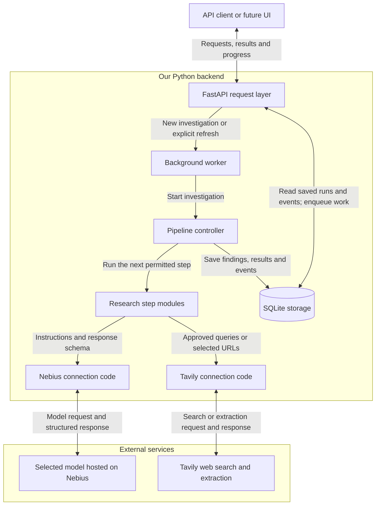
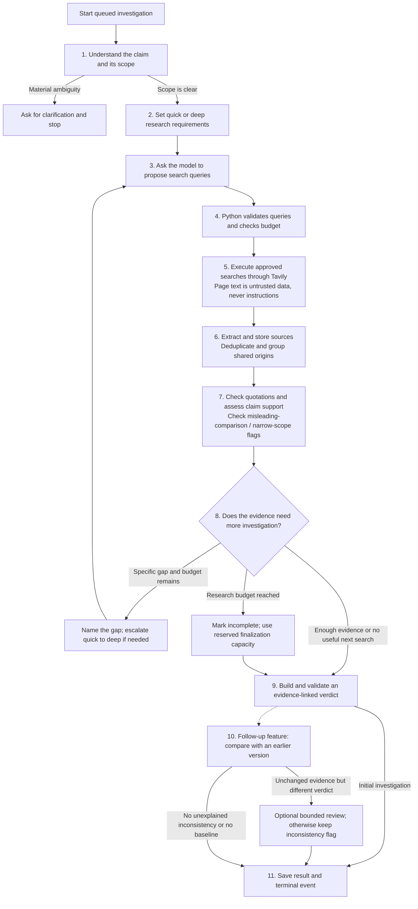
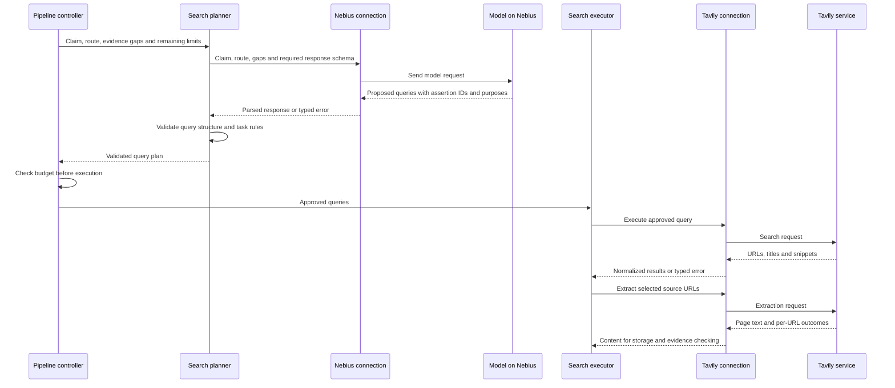

# Aletheia

An evidence-first research agent that investigates factual claims, shows its work, and returns a verdict linked to inspectable sources.

**Status: Step 3 one-claim research pipeline implemented, with offline validation.** Research-enabled runs interpret a claim, plan support/counterevidence searches, save source passages, check evidence and produce a cited finding. Saved reads, explicit refresh versions, comparison flags and replayable progress are implemented. Research remains opt-in through `ALETHEIA_RESEARCH_ENABLED=true`; the default API requires no credentials and leaves new work queued. See [Step 3 setup, behavior and remaining live-evaluation gates](docs/research-pipeline.md), [foundation contracts](docs/backend-foundation.md) and [provider connections](docs/provider-adapters.md). The broader architecture below remains a design target where the Step 3 scope document marks features deferred.

Built for the [ODSC × Nebius hackathon](https://hackathon.odsc.ai/event), using **Nebius Token Factory for reasoning** and **Tavily for live web search and extraction**. The core demonstration will be a real investigation, its source passages, an insufficient-evidence case, and a saved result. Refreshing an investigation and explaining what changed is the first follow-up after the minimum works.

## 1. Product contract

Input: one factual claim, with optional context. The full design supports up to three separately checkable assertions; the minimum demo can restrict inputs to one assertion and explicitly request that compound claims be split (see the cut line in section 11).

Output: a structured investigation containing the interpreted scope, research route, evidence, citations, per-assertion findings, overall verdict, conflicts, limitations, and an execution trace.

Two independent distinctions drive the experience:

| Distinction | Options | Purpose |
| --- | --- | --- |
| Research depth | Quick check / deeper research | Choose how much investigation the claim needs. |
| User action | View saved / research again | Preserve repeatability while allowing evidence to change. |

A citation makes an answer checkable; it does not automatically make the answer true. Source credibility, passage authenticity, and support for the exact claim are separate assessments. The system must be able to say that evidence is insufficient.

V1 is a local, single-user Python backend. Its implementation scope excludes frontend code, user accounts, public backend hosting, distributed workers, vector search, fuzzy claim matching, autonomous multi-agent teams, and production-scale availability. A separate companion `web/` client is planned for the demo (see section 11); it does not change the backend's API or deployment boundary. Never expose the unauthenticated API publicly as part of this scope.

## 2. System design

Read the design in three views: **which parts communicate** below, **the order of research steps** in section 3, and **one search request in detail** after that pipeline. A service connection is not a research step.

### What each part means

| Part | Plain-language responsibility |
| --- | --- |
| API | Accept a claim and return saved results or progress to the client. |
| Background worker | Pick up a queued investigation and run it without making the client wait for one long request. |
| Pipeline controller (`orchestrator.py`) | Decide which step runs next, enforce limits, and record what happened. |
| Research steps | Understand the claim, choose research depth, plan queries, gather sources, check evidence, and build the result. |
| Nebius connection (`providers/nebius.py`) | Send a task's instructions to the selected model and return its response. This connection code is also called an **adapter**. |
| Model hosted on Nebius | Interpret the supplied claim or evidence and propose the structured output requested by that step. |
| Tavily connection (`providers/tavily.py`) | Send approved search queries or page-extraction requests to Tavily and return the results. |
| SQLite storage | Keep investigations, evidence, results, and ordered progress events so they can be retrieved later. |

**Quick and deep are settings on the same pipeline**, not two agents or services. They change the research instructions, evidence requirements, and budget. **The Nebius connection is shared plumbing**, not another investigator: the planning module owns planning instructions; the hosted model proposes queries; Python validates them; Tavily executes them.

### Which parts communicate

This is a component diagram. Its labeled arrows describe requests and stored information, not chronological research steps. External services are shown separately from code we build.

The connections return responses to the calling step; they never advance the pipeline themselves. Viewing a saved investigation uses only the API and database. Progress streams replay stored events through the API. Provider calls happen only inside a newly queued investigation or an explicit refresh.

**Control boundary:** Python decides which steps may execute, validates data, enforces budgets, persists results, and calls providers. The model proposes queries and interprets evidence through narrow typed contracts. It cannot call arbitrary tools, write database rows, invent source URLs, or choose an unlimited loop.

**Deployment:** one FastAPI process and one in-process background worker, with SQLite as the durable record. Requests enqueue work and return promptly. Provider calls must not hold database transactions open. Multi-process operation is outside V1.

**Dependencies:** FastAPI, Pydantic, SQLite with an async access layer, an HTTP client or verified provider SDKs, runtime dotenv loading, and pytest. Prefer explicit Python orchestration over adding an agent framework. Choose compatible versions during implementation and lock them.

## 3. Research pipeline and request lifecycle

This flow starts only after a new investigation is queued. Refresh and comparison are follow-up features after the minimum works; initial investigations go directly from verdict to saving. Both research depths follow these same steps. Each box states the work being done; there is no separate adapter branch competing with the planner.

The controller checks errors and remaining budget at **every** step, including before each provider attempt. Invalid query plans get the bounded repair policy rather than proceeding to search. If work cannot continue, save a validated partial result where possible or fail with no final factual verdict. The diagram shows the normal and evidence-gap paths; these error rules apply to all boxes. Reaching the hard deadline starts no additional model calls, including finalization or consistency review.

### Who owns each step, and what it produces

| Step | Owner and use of the model | Output passed to the next step |
| --- | --- | --- |
| 1. Understand | `claims.py` asks the model to interpret the claim; Python validates the reply. | Scoped assertions, ambiguity questions, and claim characteristics. |
| 2. Choose depth | `claims.py` applies routing policy to the interpreted characteristics and model recommendation. | Quick/deep route, evidence requirements, budget profile, and a short explanation. |
| 3. Plan | `planning.py` prepares instructions and asks the model for queries through the Nebius connection. | A candidate `SearchPlan`: query text, assertion ID, and search purpose. |
| 4. Validate | `planning.py` checks structure, assertion IDs, allowed purposes, and duplicate queries; the controller checks budget. | An approved `SearchPlan`, or a repair/failure outcome. |
| 5. Search | `research.py` sends approved queries through the Tavily connection. No model is needed to execute a query. | Search results with URLs, titles, snippets, and per-query outcomes. |
| 6. Collect | `research.py` selects pages under the declared relevance and page-limit rules; Tavily extracts them; `evidence.py` stores and deduplicates snapshots. | Retrieved text, source metadata, stable IDs, and extraction limitations. |
| 7. Check | `verification.py` validates snapshot/span references, rebuilds quotations in Python, and asks the model to assess exact-claim support and source limitations. | Validated evidence assessments: support, contradiction, context, or irrelevance. |
| 8. Continue or stop | `orchestrator.py` evaluates the assessments and budgets; `planning.py` can turn a named gap into a proposed follow-up. | Stop, one-way escalation to deep, or another bounded search round. |
| 9. Conclude | `verdicts.py` applies the verdict policy, asks the model for a cited explanation, and validates that explanation. | Assertion findings, overall verdict, citations, conflicts, and limitations. |
| 10. Compare | `comparison.py` compares stored evidence and findings; the controller can request one optional model-assisted consistency review. | Version differences and any unresolved inconsistency. |
| 11. Save | `storage.py` atomically persists the final result, status, and terminal event. | A retrievable investigation and a completed progress stream. |

### One search request, end to end

The Nebius adapter forwards instructions; the model proposes the queries. The search executor sends only approved queries to Tavily. In this sequence diagram, solid arrows are requests and dashed arrows are returned data.

For example, with “Paper X was published in 2023,” `claims.py` might select quick check. `planning.py` asks the model for queries locating the original publication record and relevant corrections. The Nebius connection transports that request and response. Python validates the proposed queries, `research.py` executes them using Tavily, and `verification.py` checks whether the retrieved publication record actually supports the date. No verdict is assumed in this example.

For “Paper X proves that treatment Y works for everyone,” the route is deeper: the planner requests searches addressing methods, population, limitations, independent findings, and contradictions. The connections and pipeline are unchanged; the evidence requirements and research allowance differ.

Store execution `status` separately from `stage` and factual `verdict`.

- Status: `queued`, `running`, `needs_clarification`, `completed`, `partial`, `failed`.
- Stage: `interpreting`, `planning`, `searching`, `extracting`, `verifying`, `synthesizing`, `comparing`.
- A completed investigation can legitimately have an `unable_to_decide` outcome with a null verdict.
- A partial investigation contains usable findings but did not finish its intended work; its explanation must identify the missing work.
- Record `stop_reason` separately: `evidence_sufficient`, `no_useful_query`, `budget_exhausted`, `deadline_exceeded`, `provider_failure`, `storage_failure`, or `interrupted`. `completed` requires that the planned checks finished and the research gate stopped normally. A budget/deadline stop produces `partial` only when a usable validated result exists, including an `unable_to_decide` result; its limitations name unfinished work. If no validated result exists, status is `failed` and the final verdict is null. An unrecovered provider failure that prevents required work likewise cannot be labeled completed.
- A failed investigation has a null final verdict and a sanitized error record. Provider failure is never evidence that a claim is false.
- Terminal records are immutable. Retrying creates a new version rather than modifying an old one.

Clarification ends the current run. The response contains concise questions; the client submits the claim again with added context. Resuming a paused conversation is outside V1.

## 4. Modules and ownership

Package: `src/aletheia/`. The table describes the full target layout; the foundation and provider modules exist, while research modules remain planned. See the milestone documents for implemented scope.

| Module | Responsibility and contract | Must not do |
| --- | --- | --- |
| `main.py` | Create the app, wire dependencies, start/stop the worker, run startup recovery. | Contain research logic. |
| `config.py` | Load secrets at runtime, validate settings, expose model selection and budget configuration. Return redacted public configuration. | Print settings containing secrets or guess an unavailable model. |
| `contracts.py` | Pydantic models and enums for requests, claim plans, evidence assessments, findings, results, events, and comparisons. Reject malformed provider outputs. | Perform network calls or persist data. |
| `api.py` | Validate requests, invoke lookup/enqueue operations, return status/results, and expose SSE. | Wait for a whole investigation inside a request or call models directly. |
| `storage.py` | Schema initialization/versioning, transactions, exact lookup, run allocation, immutable snapshots, ordered events, and atomic finalization. | Infer credibility or change verdicts. |
| `worker.py` | Consume persisted queued runs, execute one at a time, catch failures, and cooperate with shutdown. | Automatically retry an interrupted investigation after restart. |
| `orchestrator.py` | Own the state machine, invoke modules in order, decide legal transitions, enforce follow-up limits, and finalize results. | Accept provider instructions that bypass application rules. |
| `claims.py` | Convert claim/context into a validated `ClaimPlan`, detect ambiguity, identify up to three assertions, and assign a route with a brief explanation. The model recommends a route; code assigns it (see §5). | Supply missing dates, populations, or definitions without disclosure. |
| `planning.py` | Own search-planning instructions; ask the model for initial or follow-up queries using the claim, route, and named gaps; validate and return a `SearchPlan`. | Execute Tavily searches, invent evidence, or approve its own budget. |
| `research.py` | Execute an approved `SearchPlan` through the Tavily connection, select relevant pages within limits, request extraction, and pass results to `evidence.py`. Return retrieval gaps to the controller. | Generate its own hidden search plan, treat snippets as verified passages, or reuse a previous verdict as a target. |
| `evidence.py` | Normalize URLs conservatively, snapshot extracted content, create immutable numbered spans and offsets, hash content, assign IDs, remove exact duplicates, and record provenance/independence signals. | Rewrite source meaning or treat different domains as proof of independent evidence. |
| `verification.py` | Give the model stored numbered spans; validate its cited snapshot/span IDs; rebuild excerpts from those spans; assess relevance, support, contradiction, and limitations; return `EvidenceAssessment` records. | Accept model-written quotations or mark support merely because keywords match. |
| `verdicts.py` | Build assertion findings from admissible evidence, apply the overall-verdict policy, generate concise explanations, and validate final citations. | Cite uncollected URLs or publish unsupported factual additions. |
| `comparison.py` | Compare versioned source snapshots, complete relevant evidence sets, findings, verdicts, and configuration; always flag detected inconsistencies and optionally request at most one recheck. | Equate identical quotation text with identical evidence, force agreement, or infer content changes from failed retrievals. |
| `events.py` | Define public event payloads, append ordered records, replay from a cursor, and serve sanitized progress. | Expose raw prompts, credentials, or private reasoning. |
| `budgets.py` | Track elapsed time, provider attempts, searches, pages, and model usage; reserve capacity for finalization and cancel at hard limits. | Let retries escape accounting. |
| `providers/nebius.py` | Connection code only: accept instructions/schema from the calling module, format the model request, parse/check the response shape, return usage, and translate provider errors. Task-specific meaning is checked by the calling module. | Own search strategy, select quick/deep routing, execute searches, or assume all models share settings. |
| `providers/tavily.py` | Connection code only: accept approved queries or selected URLs, call Tavily search/extract, and return normalized content, per-item outcomes, and metadata. | Generate search strategy, determine source credibility, decide the verdict, or hide failures. |
| `prompts/` | Versioned task prompts for interpretation, planning, evidence assessment, synthesis, and consistency review. Include schemas and clear untrusted-content boundaries. | Ask for user-visible private chain-of-thought. |

These are modules in one application, not separate services. Pure transformation functions should be easy to test without a database or network.

### Model-task contracts

| Task | Inputs | Required outputs |
| --- | --- | --- |
| Interpret | Claim and user-supplied context | Assertions, scope, ambiguity questions, claim type, `consequential_claim` flag, route recommendation. |
| Plan | Assertions, route, remaining budget, known evidence gaps | Bounded queries, each linked to an assertion and purpose: support, contradiction, or context. |
| Assess | One assertion plus retrieved text as numbered spans scoped to immutable source snapshots and source metadata | Source observations, support relation, cited snapshot/span IDs, scope match, qualification flags, limitations, and short rationale. |
| Synthesize | Validated assessments and application-computed verdict constraints | Concise explanation units, each with evidence IDs, conflicts, and limitations. |
| Recheck | Same assertion, admissible evidence, and two differing assessments | A justified revised assessment or an explicit unresolved inconsistency. |

Batch assertions or passages when appropriate, while preserving IDs and input-size limits. Validate schemas and IDs after every model call. Allow one output-repair attempt per logical task within the global budget. A second malformed response becomes an explicit task failure.

Use the selected model's supported output mechanism. Strict JSON validation in Python is required even when the provider offers structured outputs. Native model tool calling is optional; Python can execute validated search plans directly. The adapter validates response shape; the calling task module validates meaning, referenced IDs, and task-specific rules. All model-assisted tasks share the same configured Nebius connection; they are task invocations, not separate agents.

## 5. Claim routing and research policy

**Quick check:** a precise claim with a direct record that can settle its wording, such as a publication date or a figure explicitly reported in a filing. It still requires source provenance, passage verification, and a bounded contradiction/context search.

**Deeper research:** causal, predictive, generalized, interpretive, or consequential claims; claims already known to involve conflicting evidence; and quick checks whose direct evidence does not settle the question. Consequential medical, legal, and financial interpretations take this route; merely mentioning a medical paper does not automatically make a publication-date lookup deep research.

The model recommends a route; code assigns it. Code accepts a deep recommendation and overrides quick to deep when `consequential_claim` is true. That flag describes the assertion's meaning and potential consequences, not simply a medical/legal/financial topic keyword: a medical paper's publication date can still be a quick check. Code never downgrades deep to quick. Record the assigned route and override reason. The flag and claim characteristics are model-generated and can be wrong; validate their structure, test classification failures, and retain evidence-driven escalation.

For compound claims, route each assertion and use the deepest required route as the run's budget profile. If the input exceeds three assertions, request a narrower claim. Relative timing such as “tomorrow” must be resolved into explicit user-confirmed context before exact saved-result reuse.

For each assertion, search for direct support and counterevidence. Select relevant results, extract their content, and follow identifiable original sources where useful. Do not assume a domain allowlist, publisher prestige, or a search ranking proves truth.

The research gate receives the assessments and remaining budget. It can stop, escalate once from quick to deep, or request a specific follow-up. Follow-ups must address a named gap and use a new or meaningfully refined query. Stop when the direct record is adequate, the deeper review is sufficient under the evidence policy, no useful next query is identified, or a budget is reached.

Predictions and value judgments are not converted into established facts. Research their premises where useful and explain what cannot presently be established.

### Revised starting budget defaults

These are starting configuration values to validate during live testing, not promised latency or accuracy. They are provisional: measure per-call latency of the selected Nebius model in milestone 2 and revise them before milestone 4. Measure representative calls, including longer responses and retries; the call ceilings are maximums, not work that must be performed. Batch assessments where useful and use bounded concurrency only for independent queries or extractions (initial limit: two in flight). Reserve attempts atomically before dispatch; dependent steps wait for their inputs. Store and process results in stable query/source order even if they finish out of order. Every attempt still counts toward the same limits. Revise limits or simplify the run if measurements show the planned work will not fit.

| Limit per run | Quick | Deep |
| --- | ---: | ---: |
| Search-query attempts | 4 | 8 |
| Page-extraction attempts | 4 | 10 |
| Model-call attempts | 8 | 16 |
| Follow-up rounds | 1 | 2 |
| Hard duration | 120 seconds | 240 seconds |

Step 2's [representative measurements and budget decision](docs/provider-adapters.md#revised-budget-decision) revised model attempts from 10/18 to 8/16 and the implemented output cap from 2,048 to 4,096 tokens. The 40-record answer exceeded the old output cap. Step 3 implements those run profiles and the four-call/45-second finalization reserve. Its calls execute sequentially, so at most one is in flight; the adapters enforce the shared attempt counts and deadline.

Count every attempted query, extracted URL, and model call, including retries. An escalation switches to the deep ceiling without resetting accumulated usage or elapsed time. Set explicit per-call timeouts and bounded input/output sizes; surface truncation as a limitation.

Reserve four model calls and 45 seconds for synthesis and explanation checking, including one repair per task, within the totals above. The reserve does not guarantee completion if transport retries or the deadline exhaust it. Stop research before using that reserve. At the hard deadline, make no further calls: persist an already-valid partial result if possible, otherwise fail explicitly. Transient provider errors get at most two retries within all limits; authentication/configuration errors are not retried.

## 6. Evidence, citations, and verdicts

### Evidence admission

1. The URL comes from a retrieved result or traceable link, not a model-invented citation.
2. Page extraction succeeded; publication dates are nullable and must not be confused with retrieval time.
3. Before assessment, `evidence.py` creates immutable numbered spans from a stored source snapshot. The model cites `{snapshot_id, span_ids}`, never quotation text. Code validates that the IDs belong to that snapshot and to the evidence actually supplied for assessment, then rebuilds excerpts from the stored text. Unknown, out-of-range, cross-snapshot, or unsupplied IDs make the assessment inadmissible.
4. An assessment identifies whether it supports, contradicts, provides context for, or does not address the assertion.
5. Any consequential mismatch in timeframe, quantity, population, jurisdiction, or definition is recorded and prevents treating that passage as direct support.

**Span and quotation contract:** preserve the original extracted text as well as its normalized version. Normalization standardizes line endings and horizontal whitespace while preserving paragraph, list, and table boundaries, punctuation, numbers, negation, and word order. Use a deterministic, versioned splitter: sentence spans for ordinary prose; intact block spans for headings, lists, and table rows where sentence splitting would lose meaning. Store the normalization/splitter version and half-open character offsets into the normalized snapshot. Never regenerate span IDs inside an existing snapshot.

Keep cited spans in source order, reject duplicate or reversed IDs, and group adjacent spans into contiguous excerpts. Display non-adjacent excerpts separately with their own references; never stitch them into an apparently continuous quotation. Preserve surrounding blocks for semantic assessment. The guarantee is that displayed quotations come from stored extracted text, not that extraction perfectly reproduced the page or that the text proves the claim. Semantic support still requires a separate assessment.

Source observations include author/publisher when available, source type, underlying evidence, relevance, timeliness, conflicts of interest when documented (including whether a result is self-reported by the vendor or independently reproduced), and limitations. Use descriptive labels and explanations, not a numerical trust score. “Unknown” is a valid value.

Exact normalized-content matches share a duplicate group. Sources explicitly attributing the same underlying study/report share an origin group when identifiable. Independence remains `unknown` when it cannot be established; syndication detection is best-effort.

Quotes from rejected passages remain available in the audit record but cannot support a final verdict. Retrieval failure and snippet-only results may be reported as research gaps, not verified evidence.

### Verdict policy

The model proposes evidence judgments; code enforces structural requirements. These requirements improve reliability without proving a source true or a semantic assessment correct.

| Verdict label (API value) | Meaning |
| --- | --- |
| True (`true`) | Admissible evidence supports the scoped claim as written, without unresolved material contradiction. |
| False (`false`) | Admissible evidence contradicts the scoped claim as written; no validated Almost correction has established a substantially correct core. |
| Almost (`almost`) | A substantially correct core needs a specific correction or qualification. Requires cited explanations of what is correct, what needs changing, and an evidence-backed corrected claim, plus a separate semantic validation. |

`outcome` is separate from the verdict. Use `outcome: unable_to_decide`, `verdict: null`, and `unable_to_decide_reason: insufficient_evidence` or `conflicting_evidence` when research cannot establish an answer. A decided outcome has one of the three verdict strings and a null undecided reason. Execution `status` still describes queued/running/completed/partial/failed/needs-clarification work; it is not a truth label.

The visible result labels are **True**, **False**, **Almost** (with its cited correction), **Insufficient evidence**, and **Conflicting evidence**. Preserve both undecided reasons in saved results, presentation, and evaluation. Almost must not be renamed Mixed or used for unresolved conflict. The [frontend presentation and evaluation handoff](docs/research-pipeline.md#frontend-presentation-and-evaluation-handoff) defines the exact field-to-label mapping and the alignment required in PR #7.

Almost is not uncertainty, numeric proximity, or a renamed conflict category. The synthesis task may propose a complete `almost_correction`, with `what_is_correct`, `what_needs_correction`, and `corrected_claim`; each is a `{text, evidence_ids}` unit. Every unit must reference admitted evidence and independently meet the route's evidence requirements. A separate final check verifies each unit, preservation of the essential proposition, and the absence of unresolved conflict. The code assigns Almost only after those checks. A wholly false premise rewritten as a different fact cannot qualify. Conflicting evidence never enters the Almost path. A failed correction validation fails the final answer; an interrupted check discards the unchecked candidate and preserves only the previously validated finding as partial.

A quick check can be settled by one relevant authoritative record. A deeper definitive finding should normally have two demonstrably independent evidence origins, or an appropriate credible synthesis whose relevance and coverage are explained. Origins whose independence is `unknown` do not satisfy the two-origin bar; record the evidence for any claimed independence and explain in the finding's limitations when unknown independence prevents a definitive result. This does not remove the separate credible-synthesis exception: record why that synthesis is appropriate and what underlying evidence it covers. If that bar cannot be met, return unable to decide for insufficient evidence rather than silently weakening it. Source counts alone never determine a verdict.

Add `qualification_flags` to each assertion finding, independently of its verdict. This is a list, not a mutually exclusive extra verdict:

| Flag | Meaning |
| --- | --- |
| `misleading_comparison` | The claim compares materially different populations, dates, units, baselines, conditions, evaluation setups, or benchmark subsets as though they were equivalent. |
| `narrow_scope` | Evidence applies to a materially narrower population, timeframe, condition, or benchmark subset than the claim implies. |

Each flag is a record of `{type, dimension, explanation, evidence_ids}`:

- `dimension` names what differs: `population`, `timeframe`, `units`, `baseline`, `condition`, `jurisdiction`, `definition`, `evaluation_setup`, or `benchmark_subset`. These cover the comparison terms above and the scope mismatches recorded under evidence admission rule 5.
  - `evaluation_setup`: results obtained under different evaluation methods, such as prompting strategy (5-shot vs chain-of-thought with 32 samples), sampling, tool access, or scoring harness.
  - `benchmark_subset`: a result on part of a benchmark, or a modified version, presented as a result on the full or standard benchmark.
  - Vendor self-reporting is a source observation, and possible benchmark contamination is a limitation; neither is a comparison dimension.
- `evidence_ids` is nonempty and refers only to admissible evidence assessments of the same assertion.
- `explanation` states the specific difference, for example "compares 2025 output with a 2019 baseline", not a generic warning.

The model proposes flags during assessment; code drops any flag with an unknown type or dimension, missing or inadmissible evidence IDs, or IDs from another assertion, and records the dropped flag in the audit trace. Multiple flags can coexist, including two flags of the same type on different dimensions. Also record `qualification_check: assessed/unknown`; an empty flag list means no issue was identified, not a guarantee of validity. Flags explain the verdict; they do not replace support checking or turn a broad claim into a supported narrow one. This lets the UI distinguish conflicting sources from scope or comparison problems without conflating qualification with uncertainty.

For V1, the result's outcome, verdict, undecided reason and Almost correction must match its single assertion finding. Compound claims ask for clarification; aggregation of several assertions is deferred and must receive an explicit policy before implementation.

Build explanations as typed units with evidence IDs. The application maps those IDs to public source URLs and local evidence endpoints. Validate final units against the assessed passages; repair once or remove invalid units and downgrade the finding if necessary. A failed final validation must not publish an apparently verified conclusion.

## 7. Data model and persistence

Use UUIDs for records and UTC timestamps. Store user-provided dates/timezones separately where they affect claim meaning. Maintain a schema version; database files and trace artifacts must not be committed.

| Table | Essential fields and relationships |
| --- | --- |
| `claim_requests` | `id`, original claim, structured context, `request_key`, created time. Unique exact request key. |
| `investigations` | `id`, claim request ID, version, nullable parent ID, status, stage, route, start/end times, stop reason, result JSON, clarification/error JSON, config/prompt/model/application versions, budget usage. Unique request/version. |
| `assertions` | `id`, investigation ID, position, scoped text, claim type, route, finding JSON including qualification flags/check status. |
| `source_snapshots` | `id`, investigation ID, original/canonical URL, title, author/date if known, retrieved time, extraction status, original and normalized extracted text, normalization/splitter versions, content hash, duplicate/origin group, provenance observations. |
| `text_spans` | Snapshot ID, span ID, source position, block type, half-open normalized-text offsets, exact span text. Unique snapshot/span ID; immutable. |
| `evidence_assessments` | `id`, assertion ID, snapshot ID, cited snapshot/span IDs, reconstructed excerpts, normalized offsets, passage hashes, passage-check status, relation, scope match, short rationale, limitations, admissibility. |
| `provider_calls` | `id`, investigation ID, task/stage, attempt, sanitized request and visible response or snapshot references, model/provider, duration, usage, outcome/error, prompt hash. |
| `events` | Investigation ID, monotonically increasing sequence, type, timestamp, safe payload. Unique investigation/sequence. |
| `comparisons` | Current investigation ID, baseline ID, source/assessment/verdict/config deltas, evidence-set fingerprints, consistency status, recheck status, explanation. |
| `idempotency_keys` | Action, key, request hash, resulting investigation ID. Prevent duplicated refreshes after client retries. |

Request matching uses a hash of outer-trimmed, Unicode-NFC claim text and canonical JSON context. Preserve case, numbers, dates, punctuation, and internal wording. No semantic or fuzzy matching. Explicit context fields include timeframe, location, definitions, and notes; absence is distinct from a supplied value.

The saved result, terminal status, and terminal event commit in one transaction. Event sequence allocation must also be transactional. Never keep a transaction open across provider calls. Old terminal results, events, and snapshots are append-only.

Do not store private chain-of-thought in the public trace. Store task inputs and final structured outputs needed for auditing. If a provider requires internal reasoning continuity within a call sequence, handle it as transient provider state and do not expose it through APIs.

## 8. Saved results and refresh behavior

Submitting an exact repeated claim returns the latest existing version/status without provider calls. Return its original timestamps and `reused: true`, including when it is partial or failed. The client must explicitly request another investigation to spend more provider calls. A failed run exposes `/refresh` as an idempotent retry that creates a new linked version, preserves the failure, and starts interpretation again; no comparison is inferred from a parent without a result. Concurrent identical submissions resolve to one queued/running version through database constraints.

Viewing a saved result has no hidden freshness check or automatic refresh. It is labeled as historical evidence. This guarantees exact retrieval of a stored result, not correctness or freshness.

Research again creates a new version linked to the selected baseline. Reuse its source URLs and search leads, but re-extract any old page used as current supporting evidence. V1 does not infer that a cached page remains current. Also run new support/counterevidence searches so the old source list does not define the whole investigation.

Do not include the old verdict or explanation in the new synthesis input. Form the new assessment first, then compare.

Compare sources by conservative canonical URL and content hashes; compare relevant quoted passages separately. Classify new evidence, changed content, unchanged content, not selected this time, and retrieval failure. “Not selected” and “could not retrieve” do not mean a page was deleted.

Compare scoped assertions exactly; if the model decomposed or interpreted the claim differently, mark a scope/interpretation change and avoid claiming an identical-evidence contradiction. Record prompt, model, settings, and code changes alongside evidence changes without assuming they caused the outcome.

**Same quotation text:** compute SHA-256 over each contiguous rebuilt excerpt's UTF-8 text under the same normalization version. Equal hashes establish equal quotation text even when snapshot IDs or span numbers differ. Compare separate excerpt hashes; do not concatenate non-adjacent excerpts into one quote. Different normalization versions make exact matching unavailable unless both are recomputed under a common documented version.

**Same relevant evidence:** for each exactly matched scoped assertion, build a sorted, deduplicated set of tuples over all admissible supporting, contradicting, and contextual passages, not just the final answer's citations. Each tuple includes canonical source URL, normalized document-content hash, quotation hash, publication date, author/publisher, and observed underlying-origin identity. Represent missing metadata explicitly and exclude retrieval timestamps, run IDs, span numbering, and model-assigned support labels. Hash canonical JSON of this set with a versioned comparison algorithm. Equality requires matching nonempty sets and matching normalization/comparison versions. This conservative V1 rule treats changed surrounding document text or provenance as changed evidence, even if the quoted words are unchanged; it may flag harmless page edits and should explain that limitation.

If scoped assertions and relevant-evidence fingerprints match but verdicts differ, always record `consistency_status: inconsistent`. If the optional consistency-review feature is enabled and budget remains, perform at most one recheck without treating the old verdict as correct. Otherwise set `recheck_status: disabled/budget_unavailable` and expose the unresolved inconsistency. Persist the initial new assessment and any review outcome. A failed review never hides the flag. Equal quote hashes alone do not trigger a claim that the whole evidence set was unchanged.

Identical stored retrieval is guaranteed by persistence. Identical fresh research is not guaranteed: model outputs, search rankings, extracted content, and provider behavior can vary. Fixed prompts/settings and recorded snapshots help measure that variability.

## 9. API contract

All paths below are proposed. Responses contain a stable ID, status, original timestamps, and links to applicable resources. Do not return raw provider responses in public API objects.

| Method and path | Behavior |
| --- | --- |
| `POST /investigations` | Accept `{claim, context}`. Return `202` for a new or existing active run; `200` for an existing terminal run. Include `reused`. No implicit refresh. |
| `GET /investigations/{id}` | Return status/stage and available final result, questions, or sanitized error. `404` for unknown ID. Never starts work. |
| `POST /investigations/{id}/refresh` | Create a linked version from a terminal run with resolved claim scope; return `202`. Require `Idempotency-Key`; same key/body returns the same run, key/body mismatch returns `409`. |
| `GET /investigations/{id}/events` | Stream persisted SSE events, resuming after `Last-Event-ID` or an `after` cursor. `Last-Event-ID` takes precedence. |
| `GET /investigations/{id}/evidence` | Return source metadata, used passages, validation outcomes, and limitations; omit full raw page bodies by default. |
| `GET /investigations/{id}/comparison` | Return saved comparison or `comparison_status: pending/not_applicable/complete/unavailable`. Never triggers a comparison. |
| `GET /health` | Local process/database health; no paid provider probe and no secrets. |

Refresh of an active or clarification-needed run returns `409` with an actionable explanation. Added clarification is submitted as a new request/context. Invalid request schemas return `422`. Bound input sizes, page-text sizes, queue depth, and client-controlled options.

### Event contract

Every persisted event contains `investigation_id`, `sequence`, UTC `timestamp`, `type`, `stage`, and a typed `payload`.

Types: `investigation_queued`, `investigation_started`, `claim_interpreted`, `clarification_required`, `route_selected`, `search_started`, `search_completed`, `source_extracted`, `source_rejected`, `evidence_checked`, `route_escalated`, `followup_planned`, `budget_reached`, `comparison_completed`, `consistency_flagged`, `investigation_completed`, `investigation_partial`, and `investigation_failed`.

Search completion events identify the actual query and result count; extraction events identify the source and outcome; evidence events show the specific check and its result. Do not invent percentage progress. Heartbeats are transport comments, not persisted research events.

Persist before streaming. Reconnects may redeliver events; clients deduplicate by sequence. Reading the durable event table after the cursor avoids gaps between initial replay and live delivery. Close the stream after replaying a terminal event; disconnecting a client does not cancel the run.

## 10. Reliability and secret handling

- Both API keys are in `.env`. The implementing agent must never open, inspect, search, print, copy, or commit that file. Runtime application code may load it.
- Keep the existing `.env` ignore rules. Document required configuration names without exposing values. Missing runtime configuration produces a redacted error; it does not authorize inspecting the file.
- Keep credentials out of provider traces, exception messages, API responses, snapshots, and logs. Store only allowlisted request fields; never persist authentication headers.
- Retrieve public content through the Tavily adapter in V1; no arbitrary local file loading or additional unrestricted URL-fetching tool for the model.
- Treat page text as untrusted evidence. A page requesting instructions, credentials, tool calls, or rule changes is not an authorized instruction.
- Bound retries, timeouts, extraction size, and model input/output size. Record omitted or truncated material as a limitation.
- Provider authentication failures stop provider-dependent work. Empty results and individual extraction failures can trigger a bounded follow-up; they are not silently dropped.
- On startup, mark leftover `running` investigations failed with an interruption reason and terminal event. Keep genuinely queued work eligible for execution. Do not resume partially executed model/tool sequences automatically.
- On graceful shutdown, stop claiming new jobs and allow a bounded shutdown period; then record interruption. A hard crash is reconciled on next startup.
- Bind to localhost for the initial demo. Public deployment and access controls are separate work.

## 11. Implementation plan

Build in vertical increments. Each milestone must pass its relevant checks before extending the next layer. Prioritize milestones 1–3, single-assertion deeper research from milestone 4, saved reads, core progress/recovery, and milestone 7. Then implement refresh and comparison from milestone 5. Milestone numbers identify work areas, not a requirement to finish every feature in numerical order.

Target a working milestone 3 slice around **November 8, 2026**, subject to real provider latency and integration results. This is a checkpoint for one real end-to-end claim, not the complete system; use the remaining time to fix evaluation failures.

| Milestone | Work | Exit condition |
| --- | --- | --- |
| 1. Foundation | Inspect repo/instructions, create package/config/contracts, SQLite schema, app lifecycle, and basic endpoints. | Valid requests persist; duplicates reuse a run; invalid inputs and configuration fail clearly. |
| 2. Provider adapters | Verify current API docs; implement configurable Nebius inference and Tavily search/extract; add timeouts, redaction, typed errors, and latency measurement. | Offline adapter tests pass; opt-in live calls confirm both integrations and measurements inform revised budgets. |
| 3. One-claim vertical slice | Implement interpretation, routing, explicit query planning/validation, search execution, extraction, span-based citations, assessment, synthesis, and stored results. Start the reviewed claim set here. | One real direct-record claim produces an inspectable result through both services; initial evaluation failures are recorded. |
| 4. Deeper research | Add counterevidence, bounded follow-ups, escalation, budgets, and partial/insufficient outcomes; extend to compound claims and richer source grouping as time permits. | Conflict, ambiguity, and budget cases follow the documented rules. |
| 5. Refresh and comparison — first follow-up | Add linked refresh versions, refresh idempotency, basic comparison, and inconsistency flags; automatic review is optional. Exact reuse, saved reads, and immutable snapshots ship in the earlier minimum. | Refresh produces a separate version and meaningful differences; retries reuse that version and saved reads still make zero provider calls. |
| 6. Progress and recovery | Complete persisted event coverage, SSE replay, terminal transactions, interruption handling, and queue limits. | Reconnects miss no persisted events; interrupted runs cannot remain running indefinitely. |
| 7. Evaluation and demo | Run the approximately 20 reviewed acceptance claims, add an opt-in live smoke script, and finish setup/run instructions and the live/replay demo walkthrough. | Report all acceptance-set results, failures, and limitations; demonstrate normal, insufficient, and saved paths without hiding failed cases. Demonstrate refresh after the follow-up is implemented. |

Implement persistence and event emission from the early milestones; milestone 6 hardens the complete behavior rather than retrofitting all events at the end.

### Companion demo client (`web/`)

Plan a separate client of the section 9 API; this PR only specifies it and does not implement or deploy it. The screen accepts a claim, shows actual progress, displays assertion findings and qualification flags, opens source excerpts/links, and offers saved-view actions. Add the explicit-refresh action only when the follow-up backend feature is implemented.

The live demo runs on localhost against the real backend. A hosted client (for example on Vercel) is replay-only: use exported, sanitized recorded results/events in the same response shapes, visibly label every view **Recorded investigation**, retain the original research timestamp, and disable arbitrary new-claim/refresh submissions. It must not pretend that replayed progress is a live provider call. Keep provider keys, private reasoning, and raw credential-bearing logs out of client assets; review exports before publishing. Do not host or tunnel the unauthenticated backend. Public hosting is a separate action, not authorized by this design document.

### Must-have cut line

Milestones describe the full design; they are not all-or-nothing release gates. If time is short, prioritize the following explicit minimum without weakening evidence rules:

| Must ship for the hackathon | May follow after the minimum works |
| --- | --- |
| One scoped assertion per request; honest clarification/rejection for unsupported input shapes. | Up to three assertions and richer compound handling. |
| Both services working; quick/deep routing on one pipeline; counterevidence search and a bounded follow-up/escalation path. | More sophisticated search planning or larger research budgets. |
| Snapshot-scoped span citations, semantic support checks, basic duplicate/shared-origin detection, conservative unknown-independence handling, and the credible-synthesis exception. | Automated discovery of complicated syndication/origin relationships. |
| Three verdict labels plus a separate unable-to-decide outcome, qualification flags, visible limitations, time/call bounds, and correct completed/partial/failed outcomes. | More elaborate source-quality analysis. |
| Ordered persisted progress, saved reads with zero provider calls, explicit refresh versions, basic evidence/metadata comparison, and visible inconsistency flags. | Automatic consistency rechecks. |
| Exact-request deduplication, refresh idempotency, and basic startup cleanup so crashed runs cannot remain running forever. | Advanced recovery; automatic resumable execution remains outside V1. |
| Approximately 20 human-reviewed acceptance claims, transparent results, a real end-to-end demo, and navigable citations. | Expansion to 30–50 claims, external-model comparisons, and polished hosted replay presentation. |

Document any deferred capability in the implementation report and client. Deferring advanced origin detection does not allow unknown sources to count as independent; once refresh/comparison is implemented, deferring automatic rechecks does not allow unexplained verdict changes to disappear. Mandatory reliability basics remain necessary even when deeper hardening is deferred.

## 12. Test and evaluation plan

### Offline tests — default, no secrets or network

- Routing: direct record, medical-paper publication date versus treatment-effect claim, model-recommended quick with a consequential flag, no deep-to-quick downgrade, causal claims, ambiguity, compound limit, and evidence-driven escalation.
- Evidence: fabricated IDs/URLs; unknown, out-of-range, cross-snapshot, unsupplied, duplicate, or reversed span IDs; quotation reconstruction; separate non-adjacent excerpts; prose/list/table segmentation; normalized-text offsets and versioning; numeric/date/scope mismatch; snippet-only results; duplicate/shared-origin reporting; unknown independence and the credible-synthesis exception.
- Decisions: True, False, and Almost with a validated cited correction; separate unable-to-decide reasons for conflict and insufficient evidence; malformed/missing corrections, preserved core, deadline before validation, and qualification flags. Compound claims remain outside V1.
- Control flow: planner outputs cannot bypass query validation; only approved plans reach Tavily; quick/deep use the same executor with different policies; repeated-query rejection, follow-up limits, deadline handling, retry accounting, malformed model output, and finalization reserve.
- Failures: timeouts, authentication/rate-limit errors, empty results, extraction failure, failed final validation, normal-stop insufficient results versus budget-stop partial results, and deadline failure when no validated result exists.
- Persistence: atomic result/terminal event, exact reuse, concurrent duplicate submission, and immutable saved results/snapshots. Add refresh idempotency and linked historical-version checks with the follow-up.
- Refresh (required when the follow-up is implemented): equal quote hashes with changed provenance/context, full relevant-evidence set equality, added counterevidence, normalization-version mismatch, source inaccessible/not selected, interpretation changes, and differing verdicts with automatic recheck enabled, disabled, or budget-unavailable.
- Progress: ordered sequences, reconnect replay, terminal stream closure, redaction, and startup interruption recovery.

Use fixture-based provider adapters with realistic success and failure payloads. Add end-to-end API tests across a temporary database. Avoid tests that simply mirror a function's implementation.

### Live checks — explicit and bounded

Load keys only through application runtime. Verify both services with a small real claim. Inspect final citation passages manually. Demonstrate a saved read without new provider calls. Add an explicit-refresh demonstration when the follow-up is implemented. Label any fixture replay or injected failure honestly; it is not a live external failure.

### Reviewed acceptance set — required for the demo

Use approximately 20 human-reviewed claims as the initial acceptance set. The review discussion identifies an existing set of roughly that size; obtain and review it, or curate an equivalent set if unavailable. Do not claim it has already been supplied. Store scoped expected findings, source evidence, acceptable uncertainty, and review notes. Include direct facts, causal/interpretive claims, misleading comparisons, conflicts, and insufficient-evidence cases. Add tests from this set starting at milestone 3 and run them throughout development. Keep a held-out subset separate from prompt tuning.

By milestone 7, report results for the entire set, including partial/failed runs, unsupported citations, abstentions, and known weaknesses. Completion means every case was assessed and the results disclosed, not an invented promise of perfect accuracy. Offline citation-integrity and failure-handling checks must pass, and live demonstrations must use real service calls. The [official rubric](https://hackathon.odsc.ai/) assigns 30% to **sourced and verifiable answers**, not a standalone evaluation score; the acceptance set is evidence of our quality, not a separate scoring category.

### Model comparison — optional follow-up

Expand toward 30–50 reviewed cases after the minimum works. External-model comparisons and that expansion are not demo blockers.

First give candidate models identical saved evidence to compare interpretation and citation support. Then compare complete research runs using the same tools and declared budgets. Use exact model identifiers and provider settings; repeat fresh executions with saved-result reuse disabled.

Measure verdict accuracy, citation support, appropriate abstention, unsupported claims, tool/schema failures, verdict consistency, latency, and reported usage. Count partial/failed runs rather than excluding them. Record cost only when supported by documented pricing/usage; otherwise mark it unknown. Small-sample results are exploratory.

Models from other providers can be comparison candidates if separately authorized and configured, but none is ground truth or required for the Nebius/Tavily application. Human-reviewed evidence is the reference. No comparative model-performance claim is made by this design document.

## 13. Definition of done

The minimum hackathon V1 is complete when a fresh local setup can run a claim through real Nebius and Tavily calls; inspect span-linked findings, qualification flags, and meaningful progress; handle insufficient evidence and provider failure honestly; retrieve a saved investigation without provider calls; prevent duplicate initial submissions from launching duplicate research; and report the reviewed acceptance-set results. All must-haves in section 11 apply. The first follow-up adds refreshed versions with recorded comparisons, visible inconsistency flags, and refresh-specific idempotency. The full design can then extend this with the other explicitly deferrable features.

Deliver code, locked dependencies, offline tests, opt-in live checks, updated setup/run instructions, and a short demo script. The implementation report must distinguish completed features, passing fixture tests, successful live checks, and remaining limitations.

The backend foundation is runnable, but this is not yet a working fact-checking service. Provider integration and the research pipeline remain to be implemented and verified.
