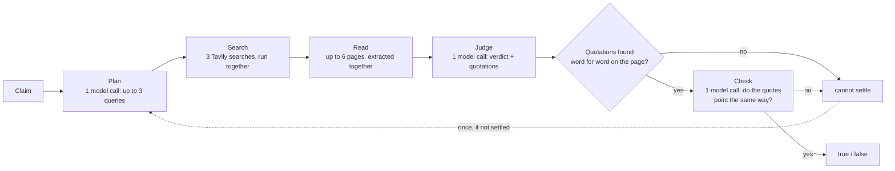

# Aletheia — Research Agent

> ODSC × Nebius Hackathon submission · Challenge: *Build a research agent that brings its sources*

**One-line pitch:** Is this factual claim true? Aletheia checks it against the live web and
answers **true**, **false** or **cannot settle**. Each true or false verdict includes a
quotation checked against a page Aletheia read. It is for anyone who has to check a claim before repeating it, and has to show where
the answer came from.

- **Demo video (2–3 min):** <!-- TODO: link -->
- **Team:** <!-- TODO: names --> [@skanvish11](https://github.com/skanvish11) · [@csalive](https://github.com/csalive)

## The problem

<!-- TODO: the demo's named user -->

A reporter, editor or analyst often has a claim in a draft: a figure, a date, a record. It
has to be checked before it goes out. Search engines return pages, and chat assistants return
answers. Neither gives a verdict that can be checked: one tied to the exact sentence on the
exact page.

Aletheia gives a verdict and the sentences it rests on, each linked to the page where it
appears. Every quotation is checked word for word against the saved page before it counts.
When the pages don't settle the claim, Aletheia says **cannot settle** instead of guessing.
The reader doesn't have to trust the verdict. They can open the source and read it.

## How it works

```
claim → plan queries → Tavily search → read pages → Token Factory verdict + quotations
      → quotations checked word for word → Token Factory check → answer with linked quotations
```



The demo runs the **simple loop** (`src/aletheia/simple.py`), with one claim per investigation.

- **Query planning:** one model call writes up to 3 search queries for the claim. If the
  first round doesn't settle the claim, the model plans one follow-up round with new
  queries aimed at what the verdict said was missing. Then it stops. Python enforces the limits: at most 6 model calls,
  6 searches and 13 page reads per claim, within 150 seconds.
- **Evidence handling:**
  - Results from the 3 searches are merged. Repeated URLs, and pages whose text matches
    one already read, are dropped. Social and video sites are skipped, and official sites
    (`.gov`, `.edu`, `.int`) are read first.
  - Up to 6 pages are read in full and saved. The model must quote the sentences its
    verdict rests on.
  - Python checks each quotation, word for word, against the saved page. A quotation that
    isn't on the page is rejected and logged.
  - A true or false verdict with no checked quotation becomes **cannot settle**. A second
    model call then checks that the quotations point the same way as the verdict.
- **Safety:**
  - The fixed instructions are the system message. Page text reaches the model only as
    data in the user message, and the instructions tell the model never to follow
    anything written on a page.
  - The model only writes queries, a verdict and quotations. Python runs every search and
    page read.
  - API keys stay in `.env`, which is git-ignored. The API has no authentication and
    listens on localhost only.
- **Trade-offs:**
  - *Latency:* the 3 searches and the page reads run in parallel. The median claim takes
    28 s with DeepSeek V4 Pro, and about 1 in 15 claims takes over 100 s.
  - *Cost:* a typical claim uses 3 model calls, 3 searches and 6 page reads.
  - *Reliability:* answers vary between runs, because search results and model output
    change. Every run is saved, and submitting the same claim again returns the saved
    result with no new provider calls.

More detail: [the simple loop](docs/simple-loop.md) and the
[full design](docs/design.md), which also covers the earlier staged pipeline.

## Required services

| Requirement | How we use it |
|---|---|
| Nebius Token Factory (inference) | Model: `deepseek-ai/DeepSeek-V4-Pro-0813`, through the OpenAI-compatible chat API with JSON-schema output. 3 calls per round: plan the queries, give the verdict with quotations, and check that the quotations point the same way as the verdict. |
| Tavily (real-time web search) | **Search:** 3 per round, `advanced` depth, 5 results each. **Extract:** up to 6 pages, then 3 in the follow-up. Each page's full text is saved with its URL. Quotations are checked against that saved text, and the answer links each quotation back to that URL, at the quoted passage. |

The research log in the web client names every Token Factory and Tavily call, and the
summary line counts them.

## Setup

Needs Python 3.12+, [uv](https://docs.astral.sh/uv/), and Node 20.19+ or 22.12+ for the
web client.

```bash
git clone https://github.com/skanvish11/Aletheia-core.git
cd Aletheia-core
cp .env.example .env        # add your NEBIUS_API_KEY and TAVILY_API_KEY — never commit them
uv sync --locked
uv run --locked aletheia    # API on http://127.0.0.1:8000
```

In a second terminal, start the web client:

```bash
cd web
npm install
VITE_DATA_SOURCE=live npm run dev   # http://127.0.0.1:5173
```

Without `VITE_DATA_SOURCE=live`, the client plays recorded investigations and needs no
backend or keys.

On Windows (PowerShell), the same steps:

```powershell
Copy-Item .env.example .env          # then add your keys
uv sync --locked
uv run --locked aletheia

# second terminal
cd web
npm install
$env:VITE_DATA_SOURCE = "live"; npm run dev
# $env: lasts for the whole terminal session. For replay mode afterwards:
# Remove-Item Env:VITE_DATA_SOURCE; npm run dev
```

Or call the API directly:

```bash
curl -s -X POST http://127.0.0.1:8000/investigations \
  -H 'content-type: application/json' \
  -d '{"claim": "An estimated 610,000 people died of malaria worldwide in 2024, according to WHO."}'
# then: GET /investigations/{id}, GET /investigations/{id}/events (live progress), GET /investigations/{id}/evidence
```

**Past investigations** are saved in `data/aletheia.sqlite3`. Submitting the same claim
again returns the saved result at once (`reused: true`), with no new search or model
calls. A saved investigation can also be opened by its ID through the API. The client
has no list of past investigations yet.

### Configuration

All settings are read from the environment or from `.env` in the repository root.
`.env.example` lists the values the demo uses.

| Variable | Demo value | Meaning |
| --- | --- | --- |
| `NEBIUS_API_KEY`, `TAVILY_API_KEY` | your keys | Required |
| `NEBIUS_MODEL` | `deepseek-ai/DeepSeek-V4-Pro-0813` | Any Token Factory chat model; there is no default |
| `ALETHEIA_RESEARCH_ENABLED` | `true` | Without it, claims are saved but never researched |
| `ALETHEIA_PIPELINE` | `simple` | `staged` (the default) is the earlier multi-step pipeline |
| `ALETHEIA_PROVIDER_TIMEOUT_SECONDS` | `120` | Per call; slower models need more than the 45 s default |
| `ALETHEIA_MODEL_MAX_OUTPUT_TOKENS` | `16384` | Reasoning models use much of this before answering |

## Example

A live run with DeepSeek V4 Pro, from the evaluation (claim `t-14`, 15 seconds, 3 model
calls, 3 searches, 6 pages read).

**Question:** An estimated 610,000 people died of malaria worldwide in 2024, according to WHO.

**Answer (excerpt):** **True.** Multiple WHO pages state that there were an estimated
610,000 malaria deaths globally in 2024, matching the claim exactly.

- "Globally in 2024, there were an estimated 282 million malaria cases and 610 000 malaria
  deaths in 80 countries." [1]
- "The estimated number of malaria deaths stood at 610 000 in 2024 compared to 598 000 in
  2023." [1]
- "Globally, in 2024, the number of deaths was estimated at 610 000, with a mortality rate
  of 13.8 per 100 000 population at risk." [2]
- "Despite this significant progress, there were an estimated 282 million malaria cases and
  610 000 deaths in 2024 – roughly 9 million more cases than the previous year." [3]

**Sources:**
[1] https://www.who.int/news-room/fact-sheets/detail/malaria ·
[2] https://www.who.int/data/gho/data/themes/malaria ·
[3] https://www.who.int/news/item/04-12-2025-new-tools-saved-a-million-lives-from-malaria-last-year-but-progress-under-threat-as-drug-resistance-rises

Each quotation was found word for word on the saved page. In the web client, clicking
one opens the source at that passage.

## Failure / insufficient-evidence case

**When the pages don't settle the claim.** Claim `u-05` from the same run: *"Exactly 87
hikers reached Mount Whitney's California summit on July 1, 2001."* No published record
we know of gives a daily summit count like that.

**Answer:** **Cannot settle** (insufficient evidence), after 40 seconds and one follow-up
round.

> The pages do not state that exactly 87 hikers reached Mount Whitney's summit on July 1,
> 2001. The only 2001 data is an aggregate figure of 16,194 people traveling up the main
> Whitney trail, which neither confirms nor contradicts a specific daily summit count.

Limitation shown to the user: "One follow-up search was run and the claim was still not
settled." The two passages it read are listed as context, not as evidence for a verdict.

**When something else goes wrong:**

| Situation | What you get |
| --- | --- |
| A quotation isn't on the page | It's rejected and logged. With no valid quotation left, the verdict becomes cannot settle |
| The quotations point the other way from the verdict | The verdict is withdrawn: cannot settle |
| A search or page read fails | The other pages are still judged. If nothing was read, the run ends **partial** with `provider_failure` |
| Time or call limit reached | Judged on the pages already read. The run ends **partial**, with the limit named |
| Key rejected or quota used up | The run **fails** with no verdict. A provider failure is never treated as evidence |

## What counts as evidence

A quotation being on a page shows that someone wrote it, not that it is true. A
manufacturer's "up to 20 hours" proves the advertisement, not a test, and a thousand pages
repeating it are still one source. So the verdict call says, for each page it relies on,
what record lies behind it and who produced it, and code keeps a true or false verdict
only on a qualifying basis: one producer's own documented record on its own site, or
documented records from two different producers. Details: [the basis check](docs/simple-loop.md#the-basis-check).

Each row below is backed by a case in the [provenance evaluation](evals/provenance/README.md)
(20 frozen claims, real verdict model, fixed pages, three runs each). Results: before the
change, 9 of the 10 unsubstantiated claims got True; after it, 0. Supported claims
correctly True: 8 before, 9 after. Full table: [results](evals/provenance/results.md).

| Handled: no true verdict from… | Case |
| --- | --- |
| Many sites repeating or rewording one announcement | U02 |
| A personal anecdote, alone or repeated as fact | U01, U06 |
| Articles citing each other in a circle | U03 |
| A repeated unofficial result with no official record | U04 |
| A spokesperson's remark, for a claim about what a report says | U05 |
| An estimate traced only to an unidentified post | U07 |
| One page stating it with no source | U08 |
| Planted pages mentioning it in passing ("the dog is blue") | U09 |
| A "lab report" copied onto sites the lab does not own | U10 |

| Kept: a true verdict from… | Case |
| --- | --- |
| A lab's own test report, with its conditions | S01, S10 |
| A company's own release, for "the company advertised…" (but not for the tested fact) | S02 |
| A benchmark maintainer's leaderboard; a race's ratified results | S03, S04 |
| An organization's own publication, for "its report states…" | S05, S07 |
| An organization's own account of its own actions or property | S08, S09 |

**Not handled** (out of scope for now):

- **Out-of-date claims.** The record's date is captured but not compared with the claim.
- **A true number used to imply something false.**
- **Cause-and-effect claims.**
- **An error inside a genuine original record.** Aletheia can show which record a
  verdict rests on; it cannot tell that the record itself is wrong.
- **A determined forger.** Pages that only state a claim never make it true, and a fake
  "official" page on someone else's site gets no credit, but a convincing fake on a
  convincing domain could pass. Every verdict names the record it rests on, so it can be
  inspected.
- **A test-conditions mismatch can still come back False** instead of cannot settle
  (case X01: a video-playback record against a web-browsing claim).
- **Search.** The evaluation uses fixed pages. It measures how Aletheia judges what it
  reads, not how often search finds the original record.
- **The staged pipeline** (not the demo) keeps its own, unchanged evidence rules.

Which parts code enforces and which still rest on the model's reading of a page is listed
in [the basis check](docs/simple-loop.md#the-basis-check).

## Accuracy

Measured on the 77 **trusted tuning claims** (`evals/claims/`), whose labels were checked by
the project owner and are never shown to the model. Runs used live Tavily search, the simple
loop and the settings above, and were scored with `scripts/score_trusted.py`.

| Model | Runs | Correct of 77 | Right when it gave true/false | Median time per claim |
| --- | ---: | ---: | ---: | ---: |
| DeepSeek V4 Pro | 2 | 66 and 66 (86%) | 60/64 and 62/67 | 40 s, then 28 s after parallel reads |
| gpt-oss-120b | 1 | 59 (77%) | 54/61 | not recorded |

- **"Correct" counts cannot settle** when that is the label. More than half of the misses
  are cannot settle where the answer was true or false. When Aletheia does answer true
  or false, it is right about 9 times in 10.
- **Answers vary between runs.** The two DeepSeek runs had the same total but differed
  on 13 of 77 claims, because search results and model output change between runs.
- **Misses are mostly judging, not search.** In most misses, the answer was on a page
  Aletheia had read.
- **A second set of 200 claims** (mostly stable, well-known facts, so easier) scored 191/200
  with DeepSeek V4 Pro and 182/200 with gpt-oss-120b, one run each.
- A held-out claim set is kept separate and will be run once at the end.

Run records, per-claim results and a diagnosis of every miss are in
[`evals/runs/`](evals/runs/) ([#35](https://github.com/skanvish11/Aletheia-core/pull/35)).

## Judging criteria map

| Criterion | Weight | Where to look |
|---|---|---|
| Sourced and verifiable answers | 30% | [Example](#example), [Failure case](#failure--insufficient-evidence-case); demo 1:00–2:15 |
| Works end to end | 25% | [Setup](#setup), [Accuracy](#accuracy); demo 0:20–2:15 |
| Usefulness | 20% | [The problem](#the-problem); demo 0:00–0:20 |
| Agent design | 15% | [How it works](#how-it-works); demo 0:20–1:00 |
| Use of Token Factory and Tavily | 10% | [Required services](#required-services); demo 0:20–1:00 |

## Repository

```text
src/aletheia/     API (FastAPI), worker, SQLite storage, the simple loop, provider adapters
web/              React + TypeScript client: live progress, verdict, quotations linked to their pages
evals/            claim sets, labels, and committed run results
scripts/          evaluation runners and scorers
tests/            offline tests; no keys or network needed
docs/             design, the simple loop, provider notes, evaluation history
```

```sh
uv run --locked pytest              # backend tests
uv run --locked ruff check .
cd web && npm test && npm run build # web client
```

## Limitations

- One claim at a time. Compound claims aren't split.
- No "almost" verdict or qualification flags in the simple loop; those belong to the
  staged pipeline.
- Quotations are checked word for word, but whether a quotation really supports the
  verdict is still the model's judgment, checked by a second model call.
- Some claims take over 100 seconds with DeepSeek V4 Pro (about 1 in 15 in the latest run).
- Local, single-user. No accounts, no public hosting of the API.

## License

MIT. See [LICENSE](LICENSE).
