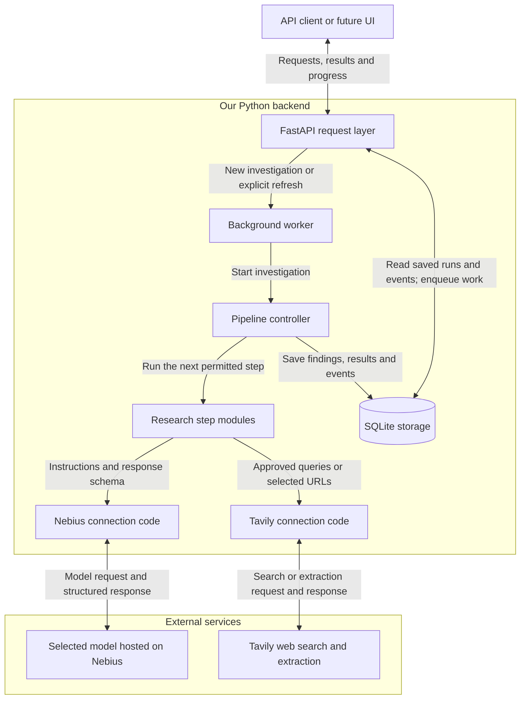
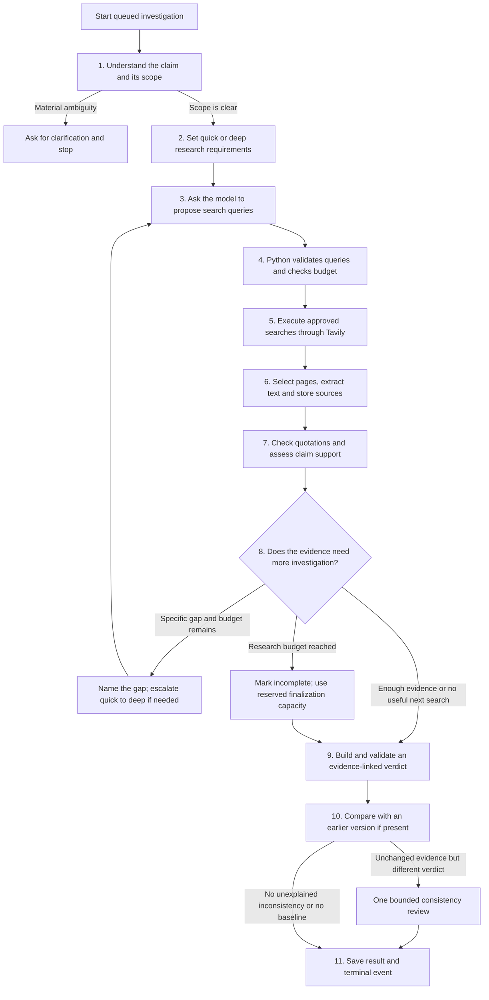
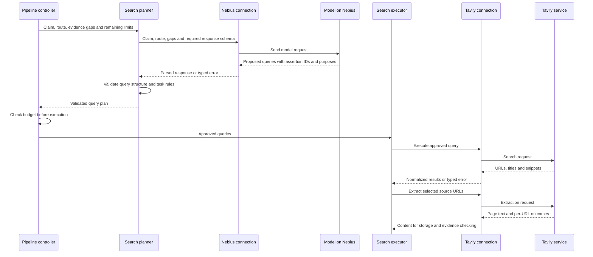

# Aletheia

An evidence-first research agent that investigates factual claims, shows its work, and returns a verdict linked to inspectable sources.

**Status: design baseline — implementation has not started.** This README defines the proposed V1 architecture, module contracts, API, and implementation plan. Names, limits, and interface shapes below are implementation targets, not claims about working software. There are no install or run commands yet.

Built for the [ODSC × Nebius hackathon](https://hackathon.odsc.ai/event), using **Nebius Token Factory for reasoning** and **Tavily for live web search and extraction**. The core demonstration will be a real investigation, its source passages, an insufficient-evidence case, a saved result, and a refreshed investigation with an explanation of what changed.

## 1. Product contract

Input: one factual claim, with optional context. A claim can contain up to three separately checkable assertions in V1.

Output: a structured investigation containing the interpreted scope, research route, evidence, citations, per-assertion findings, overall verdict, conflicts, limitations, and an execution trace.

Two independent distinctions drive the experience:

| Distinction | Options | Purpose |
| --- | --- | --- |
| Research depth | Quick check / deeper research | Choose how much investigation the claim needs. |
| User action | View saved / research again | Preserve repeatability while allowing evidence to change. |

A citation makes an answer checkable; it does not automatically make the answer true. Source credibility, passage authenticity, and support for the exact claim are separate assessments. The system must be able to say that evidence is insufficient.

V1 is a local, single-user Python backend. It excludes a frontend, user accounts, public hosting, distributed workers, vector search, fuzzy claim matching, autonomous multi-agent teams, and production-scale availability. Never expose the unauthenticated API publicly as part of this scope.

## 2. System design

Read the design in three views: **which parts communicate** below, **the order of research steps** in section 3, and **one search request in detail** after that pipeline. A service connection is not a research step.

### What each part means

| Part | Plain-language responsibility |
| --- | --- |
| API | Accept a claim and return saved results or progress to the client. |
| Background worker | Pick up a queued investigation and run it without making the client wait for one long request. |
| Pipeline controller (`orchestrator.py`) | Decide which step runs next, enforce limits, and record what happened. |
| Research steps | Understand the claim, choose research depth, plan queries, gather sources, check evidence, and build the result. |
| Nebius connection (`providers/nebius.py`) | Send a task's instructions to the selected model and return its response. This connection code is also called an **adapter**. |
| Model hosted on Nebius | Interpret the supplied claim or evidence and propose the structured output requested by that step. |
| Tavily connection (`providers/tavily.py`) | Send approved search queries or page-extraction requests to Tavily and return the results. |
| SQLite storage | Keep investigations, evidence, results, and ordered progress events so they can be retrieved later. |

**Quick and deep are settings on the same pipeline**, not two agents or services. They change the research instructions, evidence requirements, and budget. **The Nebius connection is shared plumbing**, not another investigator: the planning module owns planning instructions; the hosted model proposes queries; Python validates them; Tavily executes them.

### Which parts communicate

This is a component diagram. Its labeled arrows describe requests and stored information, not chronological research steps. External services are shown separately from code we build.

The connections return responses to the calling step; they never advance the pipeline themselves. Viewing a saved investigation uses only the API and database. Progress streams replay stored events through the API. Provider calls happen only inside a newly queued investigation or an explicit refresh.

**Control boundary:** Python decides which steps may execute, validates data, enforces budgets, persists results, and calls providers. The model proposes queries and interprets evidence through narrow typed contracts. It cannot call arbitrary tools, write database rows, invent source URLs, or choose an unlimited loop.

**Deployment:** one FastAPI process and one in-process background worker, with SQLite as the durable record. Requests enqueue work and return promptly. Provider calls must not hold database transactions open. Multi-process operation is outside V1.

**Dependencies:** FastAPI, Pydantic, SQLite with an async access layer, an HTTP client or verified provider SDKs, runtime dotenv loading, and pytest. Prefer explicit Python orchestration over adding an agent framework. Choose compatible versions during implementation and lock them.

## 3. Research pipeline and request lifecycle

This flow starts only after a new investigation is queued. Both research depths follow these same steps. Each box states the work being done; there is no separate adapter branch competing with the planner.

The controller checks errors and remaining budget at **every** step, including before each provider attempt. Invalid query plans get the bounded repair policy rather than proceeding to search. If work cannot continue, save a validated partial result where possible or fail with no final factual verdict. The diagram shows the normal and evidence-gap paths; these error rules apply to all boxes. Reaching the hard deadline starts no additional model calls, including finalization or consistency review.

### Who owns each step, and what it produces

| Step | Owner and use of the model | Output passed to the next step |
| --- | --- | --- |
| 1. Understand | `claims.py` asks the model to interpret the claim; Python validates the reply. | Scoped assertions, ambiguity questions, and claim characteristics. |
| 2. Choose depth | `claims.py` applies routing policy to the interpreted characteristics and model recommendation. | Quick/deep route, evidence requirements, budget profile, and a short explanation. |
| 3. Plan | `planning.py` prepares instructions and asks the model for queries through the Nebius connection. | A candidate `SearchPlan`: query text, assertion ID, and search purpose. |
| 4. Validate | `planning.py` checks structure, assertion IDs, allowed purposes, and duplicate queries; the controller checks budget. | An approved `SearchPlan`, or a repair/failure outcome. |
| 5. Search | `research.py` sends approved queries through the Tavily connection. No model is needed to execute a query. | Search results with URLs, titles, snippets, and per-query outcomes. |
| 6. Collect | `research.py` selects pages under the declared relevance and page-limit rules; Tavily extracts them; `evidence.py` stores and deduplicates snapshots. | Retrieved text, source metadata, stable IDs, and extraction limitations. |
| 7. Check | `verification.py` checks quotations/references in Python and asks the model to assess exact-claim support and source limitations. | Validated evidence assessments: support, contradiction, context, or irrelevance. |
| 8. Continue or stop | `orchestrator.py` evaluates the assessments and budgets; `planning.py` can turn a named gap into a proposed follow-up. | Stop, one-way escalation to deep, or another bounded search round. |
| 9. Conclude | `verdicts.py` applies the verdict policy, asks the model for a cited explanation, and validates that explanation. | Assertion findings, overall verdict, citations, conflicts, and limitations. |
| 10. Compare | `comparison.py` compares stored evidence and findings; the controller can request one model-assisted consistency review. | Version differences and any unresolved inconsistency. |
| 11. Save | `storage.py` atomically persists the final result, status, and terminal event. | A retrievable investigation and a completed progress stream. |

### One search request, end to end

The Nebius adapter forwards instructions; the model proposes the queries. The search executor sends only approved queries to Tavily. In this sequence diagram, solid arrows are requests and dashed arrows are returned data.

For example, with “Paper X was published in 2023,” `claims.py` might select quick check. `planning.py` asks the model for queries locating the original publication record and relevant corrections. The Nebius connection transports that request and response. Python validates the proposed queries, `research.py` executes them using Tavily, and `verification.py` checks whether the retrieved publication record actually supports the date. No verdict is assumed in this example.

For “Paper X proves that treatment Y works for everyone,” the route is deeper: the planner requests searches addressing methods, population, limitations, independent findings, and contradictions. The connections and pipeline are unchanged; the evidence requirements and research allowance differ.

Store execution `status` separately from `stage` and factual `verdict`.

- Status: `queued`, `running`, `needs_clarification`, `completed`, `partial`, `failed`.
- Stage: `interpreting`, `planning`, `searching`, `extracting`, `verifying`, `synthesizing`, `comparing`.
- A completed investigation can legitimately have an `insufficient_evidence` verdict.
- A partial investigation contains usable findings but did not finish its intended work; its explanation must identify the missing work.
- A failed investigation has a null final verdict and a sanitized error record. Provider failure is never evidence that a claim is false.
- Terminal records are immutable. Retrying creates a new version rather than modifying an old one.

Clarification ends the current run. The response contains concise questions; the client submits the claim again with added context. Resuming a paused conversation is outside V1.

## 4. Modules and ownership

Planned package: `src/aletheia/`. The paths below are proposed files and do not exist yet.

| Module | Responsibility and contract | Must not do |
| --- | --- | --- |
| `main.py` | Create the app, wire dependencies, start/stop the worker, run startup recovery. | Contain research logic. |
| `config.py` | Load secrets at runtime, validate settings, expose model selection and budget configuration. Return redacted public configuration. | Print settings containing secrets or guess an unavailable model. |
| `contracts.py` | Pydantic models and enums for requests, claim plans, evidence assessments, findings, results, events, and comparisons. Reject malformed provider outputs. | Perform network calls or persist data. |
| `api.py` | Validate requests, invoke lookup/enqueue operations, return status/results, and expose SSE. | Wait for a whole investigation inside a request or call models directly. |
| `storage.py` | Schema initialization/versioning, transactions, exact lookup, run allocation, immutable snapshots, ordered events, and atomic finalization. | Infer credibility or change verdicts. |
| `worker.py` | Consume persisted queued runs, execute one at a time, catch failures, and cooperate with shutdown. | Automatically retry an interrupted investigation after restart. |
| `orchestrator.py` | Own the state machine, invoke modules in order, decide legal transitions, enforce follow-up limits, and finalize results. | Accept provider instructions that bypass application rules. |
| `claims.py` | Convert claim/context into a validated `ClaimPlan`, detect ambiguity, identify up to three assertions, and assign a route with a brief explanation. | Supply missing dates, populations, or definitions without disclosure. |
| `planning.py` | Own search-planning instructions; ask the model for initial or follow-up queries using the claim, route, and named gaps; validate and return a `SearchPlan`. | Execute Tavily searches, invent evidence, or approve its own budget. |
| `research.py` | Execute an approved `SearchPlan` through the Tavily connection, select relevant pages within limits, request extraction, and pass results to `evidence.py`. Return retrieval gaps to the controller. | Generate its own hidden search plan, treat snippets as verified passages, or reuse a previous verdict as a target. |
| `evidence.py` | Normalize URLs conservatively, snapshot extracted content, hash it, assign IDs, remove exact duplicates, and record provenance/independence signals. | Treat different domains as proof of independent evidence. |
| `verification.py` | Validate passage membership and evidence references in code; ask the model to assess relevance, support, contradiction, and limitations; return `EvidenceAssessment` records. | Mark a passage as supporting merely because keywords match. |
| `verdicts.py` | Build assertion findings from admissible evidence, apply the overall-verdict policy, generate concise explanations, and validate final citations. | Cite uncollected URLs or publish unsupported factual additions. |
| `comparison.py` | Compare versioned source snapshots, findings, verdicts, and configuration; flag inconsistencies and request at most one recheck. | Force agreement with the old result or infer content changes from failed retrievals. |
| `events.py` | Define public event payloads, append ordered records, replay from a cursor, and serve sanitized progress. | Expose raw prompts, credentials, or private reasoning. |
| `budgets.py` | Track elapsed time, provider attempts, searches, pages, and model usage; reserve capacity for finalization and cancel at hard limits. | Let retries escape accounting. |
| `providers/nebius.py` | Connection code only: accept instructions/schema from the calling module, format the model request, parse/check the response shape, return usage, and translate provider errors. Task-specific meaning is checked by the calling module. | Own search strategy, select quick/deep routing, execute searches, or assume all models share settings. |
| `providers/tavily.py` | Connection code only: accept approved queries or selected URLs, call Tavily search/extract, and return normalized content, per-item outcomes, and metadata. | Generate search strategy, determine source credibility, decide the verdict, or hide failures. |
| `prompts/` | Versioned task prompts for interpretation, planning, evidence assessment, synthesis, and consistency review. Include schemas and clear untrusted-content boundaries. | Ask for user-visible private chain-of-thought. |

These are modules in one application, not separate services. Pure transformation functions should be easy to test without a database or network.

### Model-task contracts

| Task | Inputs | Required outputs |
| --- | --- | --- |
| Interpret | Claim and user-supplied context | Assertions, scope, ambiguity questions, claim type, consequential-domain flag, route recommendation. |
| Plan | Assertions, route, remaining budget, known evidence gaps | Bounded queries, each linked to an assertion and purpose: support, contradiction, or context. |
| Assess | One assertion plus labeled retrieved passages and source metadata | Source observations, support relation, exact quotation, scope match, limitations, and short rationale. |
| Synthesize | Validated assessments and application-computed verdict constraints | Concise explanation units, each with evidence IDs, conflicts, and limitations. |
| Recheck | Same assertion, admissible evidence, and two differing assessments | A justified revised assessment or an explicit unresolved inconsistency. |

Batch assertions or passages when appropriate, while preserving IDs and input-size limits. Validate schemas and IDs after every model call. Allow one output-repair attempt per logical task within the global budget. A second malformed response becomes an explicit task failure.

Use the selected model's supported output mechanism. Strict JSON validation in Python is required even when the provider offers structured outputs. Native model tool calling is optional; Python can execute validated search plans directly. The adapter validates response shape; the calling task module validates meaning, referenced IDs, and task-specific rules. All model-assisted tasks share the same configured Nebius connection; they are task invocations, not separate agents.

## 5. Claim routing and research policy

**Quick check:** a precise claim with a direct record that can settle its wording, such as a publication date or a figure explicitly reported in a filing. It still requires source provenance, passage verification, and a bounded contradiction/context search.

**Deeper research:** causal, predictive, generalized, interpretive, or consequential claims; claims already known to involve conflicting evidence; and quick checks whose direct evidence does not settle the question. Consequential medical, legal, and financial interpretations take this route; merely mentioning a medical paper does not automatically make a publication-date lookup deep research.

For compound claims, route each assertion and use the deepest required route as the run's budget profile. If the input exceeds three assertions, request a narrower claim. Relative timing such as “tomorrow” must be resolved into explicit user-confirmed context before exact saved-result reuse.

For each assertion, search for direct support and counterevidence. Select relevant results, extract their content, and follow identifiable original sources where useful. Do not assume a domain allowlist, publisher prestige, or a search ranking proves truth.

The research gate receives the assessments and remaining budget. It can stop, escalate once from quick to deep, or request a specific follow-up. Follow-ups must address a named gap and use a new or meaningfully refined query. Stop when the direct record is adequate, the deeper review is sufficient under the evidence policy, no useful next query is identified, or a budget is reached.

Predictions and value judgments are not converted into established facts. Research their premises where useful and explain what cannot presently be established.

### Initial budget defaults

These are starting configuration values to validate during live testing, not promised latency or accuracy.

| Limit per run | Quick | Deep |
| --- | ---: | ---: |
| Search-query attempts | 4 | 8 |
| Page-extraction attempts | 4 | 10 |
| Model-call attempts | 10 | 18 |
| Follow-up rounds | 1 | 2 |
| Hard duration | 120 seconds | 240 seconds |

Count every attempted query, extracted URL, and model call, including retries. An escalation switches to the deep ceiling without resetting accumulated usage or elapsed time. Set explicit per-call timeouts and bounded input/output sizes; surface truncation as a limitation.

Reserve three model calls and a configurable time allowance for synthesis, final checks, and comparison review. Stop research before using that reserve. At the hard deadline, make no further calls: persist an already-valid partial result if possible, otherwise fail explicitly. Transient provider errors get at most two retries within all limits; authentication/configuration errors are not retried.

## 6. Evidence, citations, and verdicts

### Evidence admission

1. The URL comes from a retrieved result or traceable link, not a model-invented citation.
2. Page extraction succeeded; publication dates are nullable and must not be confused with retrieval time.
3. The quoted passage occurs in the stored extracted text after conservative whitespace normalization. Store its location in the normalized text.
4. An assessment identifies whether it supports, contradicts, provides context for, or does not address the assertion.
5. Any consequential mismatch in timeframe, quantity, population, jurisdiction, or definition is recorded and prevents treating that passage as direct support.

Source observations include author/publisher when available, source type, underlying evidence, relevance, timeliness, conflicts of interest when documented, and limitations. Use descriptive labels and explanations, not a numerical trust score. “Unknown” is a valid value.

Exact normalized-content matches share a duplicate group. Sources explicitly attributing the same underlying study/report share an origin group when identifiable. Independence remains `unknown` when it cannot be established; syndication detection is best-effort.

Quotes from rejected passages remain available in the audit record but cannot support a final verdict. Retrieval failure and snippet-only results may be reported as research gaps, not verified evidence.

### Verdict policy

The model proposes evidence judgments; code enforces structural requirements. These requirements improve reliability without proving a source true or a semantic assessment correct.

| Assertion verdict | Meaning |
| --- | --- |
| `supported` | Admissible evidence directly supports the scoped claim, with no unresolved material contradiction. |
| `contradicted` | Admissible evidence directly contradicts the scoped claim, with no unresolved material support that would make the conclusion disputed. |
| `mixed` | Material supporting and contradicting evidence remains unresolved, or the assertion is only partly supported under materially different conditions. |
| `insufficient_evidence` | Available admissible evidence does not justify any of the above. Missing support alone is not contradiction. |

A quick check can be settled by one relevant authoritative record. A deeper definitive finding should normally have two demonstrably independent evidence origins, or an appropriate credible synthesis whose relevance and coverage are explained. If that bar cannot be met, return insufficient evidence rather than silently weakening it. Source counts alone never determine a verdict.

For a single assertion, the overall verdict matches its verdict. For a compound claim: all supported means supported; all contradicted means contradicted; any insufficient finding means overall insufficient evidence with established sub-findings retained; otherwise return mixed. This is a transparent summary convention, not a claim to evaluate arbitrary formal logic.

Build explanations as typed units with evidence IDs. The application maps those IDs to public source URLs and local evidence endpoints. Validate final units against the assessed passages; repair once or remove invalid units and downgrade the finding if necessary. A failed final validation must not publish an apparently verified conclusion.

## 7. Data model and persistence

Use UUIDs for records and UTC timestamps. Store user-provided dates/timezones separately where they affect claim meaning. Maintain a schema version; database files and trace artifacts must not be committed.

| Table | Essential fields and relationships |
| --- | --- |
| `claim_requests` | `id`, original claim, structured context, `request_key`, created time. Unique exact request key. |
| `investigations` | `id`, claim request ID, version, nullable parent ID, status, stage, route, start/end times, result JSON, clarification/error JSON, config/prompt/model/application versions, budget usage. Unique request/version. |
| `assertions` | `id`, investigation ID, position, scoped text, claim type, route, finding JSON. |
| `source_snapshots` | `id`, investigation ID, original/canonical URL, title, author/date if known, retrieved time, extraction status, extracted text, content hash, duplicate/origin group, provenance observations. |
| `evidence_assessments` | `id`, assertion ID, snapshot ID, quotation, normalized offsets, passage-check status, relation, scope match, short rationale, limitations, admissibility. |
| `provider_calls` | `id`, investigation ID, task/stage, attempt, sanitized request and visible response or snapshot references, model/provider, duration, usage, outcome/error, prompt hash. |
| `events` | Investigation ID, monotonically increasing sequence, type, timestamp, safe payload. Unique investigation/sequence. |
| `comparisons` | Current investigation ID, baseline ID, source/assessment/verdict/config deltas, consistency status, explanation. |
| `idempotency_keys` | Action, key, request hash, resulting investigation ID. Prevent duplicated refreshes after client retries. |

Request matching uses a hash of outer-trimmed, Unicode-NFC claim text and canonical JSON context. Preserve case, numbers, dates, punctuation, and internal wording. No semantic or fuzzy matching. Explicit context fields include timeframe, location, definitions, and notes; absence is distinct from a supplied value.

The saved result, terminal status, and terminal event commit in one transaction. Event sequence allocation must also be transactional. Never keep a transaction open across provider calls. Old terminal results, events, and snapshots are append-only.

Do not store private chain-of-thought in the public trace. Store task inputs and final structured outputs needed for auditing. If a provider requires internal reasoning continuity within a call sequence, handle it as transient provider state and do not expose it through APIs.

## 8. Saved results and refresh behavior

Submitting an exact repeated claim returns the latest existing version/status without provider calls. Return its original timestamps and `reused: true`, including when it is partial or failed. The client must explicitly request another investigation to spend more provider calls. Concurrent identical submissions resolve to one queued/running version through database constraints.

Viewing a saved result has no hidden freshness check or automatic refresh. It is labeled as historical evidence. This guarantees exact retrieval of a stored result, not correctness or freshness.

Research again creates a new version linked to the selected baseline. Reuse its source URLs and search leads, but re-extract any old page used as current supporting evidence. V1 does not infer that a cached page remains current. Also run new support/counterevidence searches so the old source list does not define the whole investigation.

Do not include the old verdict or explanation in the new synthesis input. Form the new assessment first, then compare.

Compare sources by conservative canonical URL and content hashes; compare relevant quoted passages separately. Classify new evidence, changed content, unchanged content, not selected this time, and retrieval failure. “Not selected” and “could not retrieve” do not mean a page was deleted.

Compare scoped assertions exactly; if the model decomposed or interpreted the claim differently, mark a scope/interpretation change and avoid claiming an identical-evidence contradiction. Record prompt, model, settings, and code changes alongside evidence changes without assuming they caused the outcome.

If matched assertions use the same relevant passages but have different verdicts, request one recheck, without treating the previous conclusion as correct. If unresolved, publish a visible inconsistency limitation. Persist both the initial new assessment and the recheck outcome in the audit record.

Identical stored retrieval is guaranteed by persistence. Identical fresh research is not guaranteed: model outputs, search rankings, extracted content, and provider behavior can vary. Fixed prompts/settings and recorded snapshots help measure that variability.

## 9. API contract

All paths below are proposed. Responses contain a stable ID, status, original timestamps, and links to applicable resources. Do not return raw provider responses in public API objects.

| Method and path | Behavior |
| --- | --- |
| `POST /investigations` | Accept `{claim, context}`. Return `202` for a new or existing active run; `200` for an existing terminal run. Include `reused`. No implicit refresh. |
| `GET /investigations/{id}` | Return status/stage and available final result, questions, or sanitized error. `404` for unknown ID. Never starts work. |
| `POST /investigations/{id}/refresh` | Create a linked version from a terminal run with resolved claim scope; return `202`. Require `Idempotency-Key`; same key/body returns the same run, key/body mismatch returns `409`. |
| `GET /investigations/{id}/events` | Stream persisted SSE events, resuming after `Last-Event-ID` or an `after` cursor. `Last-Event-ID` takes precedence. |
| `GET /investigations/{id}/evidence` | Return source metadata, used passages, validation outcomes, and limitations; omit full raw page bodies by default. |
| `GET /investigations/{id}/comparison` | Return saved comparison or `comparison_status: pending/not_applicable/complete/unavailable`. Never triggers a comparison. |
| `GET /health` | Local process/database health; no paid provider probe and no secrets. |

Refresh of an active or clarification-needed run returns `409` with an actionable explanation. Added clarification is submitted as a new request/context. Invalid request schemas return `422`. Bound input sizes, page-text sizes, queue depth, and client-controlled options.

### Event contract

Every persisted event contains `investigation_id`, `sequence`, UTC `timestamp`, `type`, `stage`, and a typed `payload`.

Types: `investigation_queued`, `investigation_started`, `claim_interpreted`, `clarification_required`, `route_selected`, `search_started`, `search_completed`, `source_extracted`, `source_rejected`, `evidence_checked`, `route_escalated`, `followup_planned`, `budget_reached`, `comparison_completed`, `consistency_flagged`, `investigation_completed`, `investigation_partial`, and `investigation_failed`.

Search completion events identify the actual query and result count; extraction events identify the source and outcome; evidence events show the specific check and its result. Do not invent percentage progress. Heartbeats are transport comments, not persisted research events.

Persist before streaming. Reconnects may redeliver events; clients deduplicate by sequence. Reading the durable event table after the cursor avoids gaps between initial replay and live delivery. Close the stream after replaying a terminal event; disconnecting a client does not cancel the run.

## 10. Reliability and secret handling

- Both API keys are in `.env`. The implementing agent must never open, inspect, search, print, copy, or commit that file. Runtime application code may load it.
- Keep the existing `.env` ignore rules. Document required configuration names without exposing values. Missing runtime configuration produces a redacted error; it does not authorize inspecting the file.
- Keep credentials out of provider traces, exception messages, API responses, snapshots, and logs. Store only allowlisted request fields; never persist authentication headers.
- Retrieve public content through the Tavily adapter in V1; no arbitrary local file loading or additional unrestricted URL-fetching tool for the model.
- Treat page text as untrusted evidence. A page requesting instructions, credentials, tool calls, or rule changes is not an authorized instruction.
- Bound retries, timeouts, extraction size, and model input/output size. Record omitted or truncated material as a limitation.
- Provider authentication failures stop provider-dependent work. Empty results and individual extraction failures can trigger a bounded follow-up; they are not silently dropped.
- On startup, mark leftover `running` investigations failed with an interruption reason and terminal event. Keep genuinely queued work eligible for execution. Do not resume partially executed model/tool sequences automatically.
- On graceful shutdown, stop claiming new jobs and allow a bounded shutdown period; then record interruption. A hard crash is reconciled on next startup.
- Bind to localhost for the initial demo. Public deployment and access controls are separate work.

## 11. Implementation plan

Build in vertical increments. Each milestone must pass its relevant checks before extending the next layer.

| Milestone | Work | Exit condition |
| --- | --- | --- |
| 1. Foundation | Inspect repo/instructions, create package/config/contracts, SQLite schema, app lifecycle, and basic endpoints. | Valid requests persist; duplicates reuse a run; invalid inputs and configuration fail clearly. |
| 2. Provider adapters | Verify current API docs; implement configurable Nebius inference and Tavily search/extract; add timeouts, redaction, and typed errors. | Offline adapter tests pass; small opt-in live calls confirm both integrations. |
| 3. One-claim vertical slice | Implement interpretation, quick routing, explicit query planning/validation, search execution, extraction, passage checking, assessment, synthesis, and stored citations. | One real direct-record claim produces an inspectable result through both services. |
| 4. Deeper research | Add compound-claim handling, counterevidence, source grouping, follow-ups, escalation, budgets, and partial/insufficient outcomes. | Conflict, ambiguity, and budget cases follow the documented rules. |
| 5. Saved versions | Add exact reuse, refresh idempotency, immutable snapshots, comparison, and bounded inconsistency review. | Saved reads make zero provider calls; refresh produces a separate version and meaningful differences. |
| 6. Progress and recovery | Complete persisted event coverage, SSE replay, terminal transactions, interruption handling, and queue limits. | Reconnects miss no persisted events; interrupted runs cannot remain running indefinitely. |
| 7. Evaluation and demo | Add reviewed claim fixtures, an opt-in live smoke script, setup/run documentation, and a reproducible demo walkthrough. | Report which offline/live checks passed and demonstrate normal, insufficient, saved, and refreshed paths. |

Implement persistence and event emission from the early milestones; milestone 6 hardens the complete behavior rather than retrofitting all events at the end.

## 12. Test and evaluation plan

### Offline tests — default, no secrets or network

- Routing: direct record, causal claim, consequential interpretation, ambiguity, compound limit, and quick-to-deep escalation.
- Evidence: fabricated ID, invented URL, quotation mismatch, whitespace-normalized quote, numeric/date/scope mismatch, snippet-only result, duplicate content, and shared-origin reporting.
- Verdicts: supported, contradicted, unresolved conflict, insufficient evidence, and every compound aggregation branch.
- Control flow: planner outputs cannot bypass query validation; only approved plans reach Tavily; quick/deep use the same executor with different policies; repeated-query rejection, follow-up limits, deadline handling, retry accounting, malformed model output, and finalization reserve.
- Failures: timeouts, authentication/rate-limit errors, empty results, extraction failure, failed final validation, and partial versus failed outcomes.
- Persistence: atomic result/terminal event, exact reuse, concurrent duplicate submission, refresh idempotency, and immutable historical versions.
- Refresh: changed evidence, unchanged evidence, source inaccessible, source not selected, interpretation changes, and differing verdicts on identical passages.
- Progress: ordered sequences, reconnect replay, terminal stream closure, redaction, and startup interruption recovery.

Use fixture-based provider adapters with realistic success and failure payloads. Add end-to-end API tests across a temporary database. Avoid tests that simply mirror a function's implementation.

### Live checks — explicit and bounded

Load keys only through application runtime. Verify both services with a small real claim. Inspect final citation passages manually. Demonstrate a saved read without new provider calls and an explicit refresh. Label any fixture replay or injected failure honestly; it is not a live external failure.

### Model comparison — evaluation infrastructure, not a V1 release blocker

Start with a small manually reviewed claim set, then expand toward 30–50 cases. Store expected findings, scoped evidence, acceptable uncertainty, and review notes. Keep a held-out subset separate from prompt tuning.

First give candidate models identical saved evidence to compare interpretation and citation support. Then compare complete research runs using the same tools and declared budgets. Use exact model identifiers and provider settings; repeat fresh executions with saved-result reuse disabled.

Measure verdict accuracy, citation support, appropriate abstention, unsupported claims, tool/schema failures, verdict consistency, latency, and reported usage. Count partial/failed runs rather than excluding them. Record cost only when supported by documented pricing/usage; otherwise mark it unknown. Small-sample results are exploratory.

GPT-6 Astra can be a comparison candidate if separately authorized and configured, but is not ground truth and is not required for the Nebius/Tavily application. Human-reviewed evidence is the reference. No comparative model-performance claim is made by this design document.

## 13. Definition of done

V1 is complete when a fresh local setup can run a claim through real Nebius and Tavily calls; inspect evidence-linked findings and meaningful progress; handle insufficient evidence and provider failure honestly; retrieve a saved investigation without provider calls; and create a refreshed version with a recorded comparison.

Deliver code, locked dependencies, offline tests, opt-in live checks, updated setup/run instructions, and a short demo script. The implementation report must distinguish completed features, passing fixture tests, successful live checks, and remaining limitations.

Until those milestones are implemented and verified, this repository is a design specification, not a working fact-checking service.
