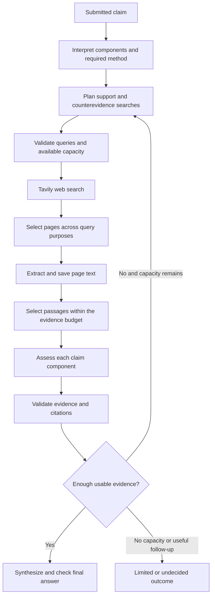
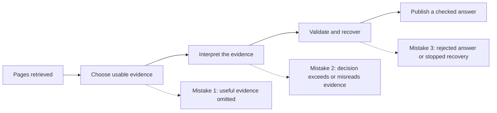
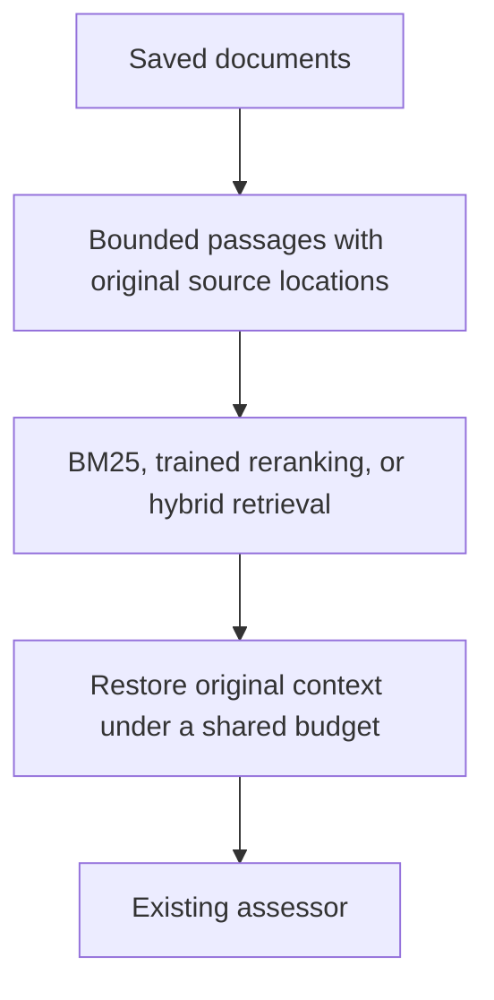

# Backend search diagnosis and experiment discussion

This records the discussion in **Explain backend search logic** on November 10–11, 2026, through the November 11 retrieval-comparison results and authorization to repair quotation handling and test exact-outcome retrieval and context allocation separately. It explains the implemented search flow, the four pilot investigations, competing hypotheses, completed experiments, corrections to earlier recommendations, and the agreed next work.

The central finding was that useful information often reached the backend but failed to become usable evidence or a final answer. Bounded passage splitting repaired a demonstrated Python failure in experiments. It did not establish reliable retrieval generally, and isolated assessment improvements did not improve completion in the full pipeline replay. The latest user direction was to stay focused on evidence selection: repair a newly reproduced quotation bug in isolation, then test exact-outcome retrieval and context allocation separately.

**Status at this discussion cutoff:** the established-retrieval comparison had completed; the quotation repair and separate retrieval/context experiments were running. Their results are not included as completed findings. Experimental changes described below were not promoted to production by this discussion. This documentation change itself changes no runtime behavior.

## Reading guide and evidence boundaries

- Sections 1–3 describe the implementation and historical pilot traces discussed in the chat.
- Sections 4–6 preserve design alternatives, hypotheses, and the diagnostic plan.
- Sections 7–9 record completed experiments and why the focus returned to evidence selection.
- Sections 10–12 capture the latest direction, remaining questions, and source inventory.

Historical pilot behavior, the newer experimental baseline, and proposed changes are different states. The later assessment baseline was frozen at revision `0246699`; historical errors should not automatically be attributed to that newer revision. The local experiment directories listed at the end are outside the repository. Their results are summarized here, but the experiment bundles and saved pages are not shipped in this PR.

## 1. How backend search was implemented

Tavily performed web search and supplied ranked results. Aletheia controlled query planning, page selection, extraction, passage selection, evidence assessment, validation, follow-up research, and finalization.



### Query planning and web search

The model identified material claim components and selected a supported research method. Direct facts and compatible comparisons could proceed; unclear claims could require clarification, and unsupported methods could stop before search.

The planner proposed up to three queries per round. A nonempty initial plan normally included support and contradiction purposes. Code rejected duplicates after normalizing case and whitespace. Follow-up queries needed an evidence gap and had to fit the remaining capacity. The planner received prior queries, evidence summaries, and remaining budgets.

The inspected Tavily search configuration used `max_results=5`, `search_depth=advanced`, and `topic=general`. Answer generation, raw content in search results, images, and automatic parameters were disabled. Searches ran sequentially, without domain restrictions, date filters, or an Aletheia-specific web ranking model in this path.

### Page selection and extraction

Within each query, results were ordered by Tavily score. The backend interleaved query lists across support, contradiction, and context purposes, taking unseen URLs until the page or extraction limit was reached. With two support queries and one contradiction query, this could select support A's first result, then the contradiction query's first result, then support B's first result.

Initial fresh-page limits were two for quick research and four for deep research, with two per follow-up round. Explicit refreshes could reserve up to two previously cited pages. Source authority was evaluated after extraction rather than through a separate authority-based page ranking.

A contradiction query's purpose did not guarantee contradictory results. The SHA-256 trace demonstrated this directly: its contradiction query retrieved text supporting the claim.

Selected URLs used basic Tavily extraction into Markdown. Search snippets were not treated as evidence. Saved snapshots contained numbered passages, exact text positions, and normalized-content hashes. Identical content could be stored without being assessed again. URL deduplication removed fragments and normalized scheme and host case while retaining query parameters.

### Passage selection and assessment

The local selector removed recognizable navigation and link-only passages. It scored remaining text with claim-word matches weighted by their rarity across the page:

```text
score(passage) = sum over matching claim words of
                 1 / number of passages containing that word
```

It selected high-scoring passages and immediate neighbors within **12,000 characters and 120 passages per source**, then restored source order. This was keyword retrieval without embeddings or a trained reranker. Scoring used the whole assertion, without reserving evidence coverage for every component.

The model then classified evidence as support, contradiction, context, or irrelevant and judged scope, authority, and provenance. Code validated references and reconstructed quotations from saved text. Comparison claims required additional value and compatibility checks. Citation integrity did not itself establish that the model's interpretation was correct.

Research could target conflict, source quality or independence, scope mismatch, or missing evidence. At most two follow-up rounds were allowed. Quick research could escalate to deep research while retaining spent calls and elapsed time.

| Shared allowance | Quick | Deep |
|---|---:|---:|
| Search attempts | 4 | 8 |
| Extracted URL attempts | 4 | 10 |
| Model attempts | 8 | 16 |
| Deadline | 120 seconds | 240 seconds |

Retries consumed those allowances. Four model attempts and 45 seconds were reserved for finalization. In the historical quick runs, this left four model calls for interpretation, planning, assessment, and their repairs. Several runs stopped with roughly 100 seconds still available: the immediate constraint was model-call capacity, not elapsed time.

## 2. Four historical pilot walkthroughs

These walkthroughs reconstructed selection from saved snapshots and the pilot revision. They were not fresh searches. Complete ranked lists of unselected search hits and rejected model responses were not retained, so some failures can only be localized to an error category.

### Python release date — b0012

Claim: “The original version of the Python programming language was first publicly released in 2001.”

| Purpose | Exact query | Results |
|---|---|---:|
| Support | `Python programming language first public release date 2001` | 5 |
| Support | `Guido van Rossum Python language release year` | 5 |
| Contradiction | `Python 0.9.0 initial release year` | 5 |

Purpose balancing selected a UBC-hosted paper, **Python as a First Programming Language for Everyone**, and a YouTube Short, **Python Version History: The Ultimate Guide (1991–Present)**. Eleven URLs were deferred.

The UBC extraction had 37,545 characters but only three passages: an empty table header, a table separator, and a 37,522-character table row containing almost the entire paper. The row contained the public-release year, 1991. The splitter kept it indivisible, and the selector skipped it because it exceeded 12,000 characters. Only **18 characters of table formatting** reached assessment. The model correctly described its supplied input as lacking readable release information and saved context assessments.

All 14 passages of the YouTube extraction fit. They included the initial version and a February 20, 1991 release statement. That assessment failed `comparison_values`. The rejected response was unavailable, so the exact invalid field was unknown.

The four research calls were interpretation, planning, UBC assessment, and YouTube assessment. Repair was blocked by `model_finalization_reserve`, with about 101 seconds remaining. Research exited before ordinary end-of-round escalation. Finalization then failed semantic checks; the saved state was `failed`, `semantic_rejection`, and no result after about 22 seconds.

**Finding:** search retrieved useful evidence twice. One source lost it during selection; the other lost it during assessment validation. Budget handling prevented repair, and finalization did not produce a publishable answer.

### Venus — b0002

Claim: “Venus is the closest planet to the Sun.”

| Purpose | Exact query | Results |
|---|---|---:|
| Support | `Venus distance from Sun astronomical units` | 5 |
| Contradiction | `Mercury distance from Sun astronomical units` | 5 |
| Context | `Venus orbital position relative to Mercury orbital position` | 5 |

Selected pages were NASA's **Venus Facts** and UK Cloud Magnets' **Mercury** page; twelve URLs were deferred. The NASA page yielded 115 selected passages and 11,999 characters, including the statement that Venus is second from the Sun and a distance of 0.72 AU. The extracted Mercury page included 0.4 AU, but its assessment never ran.

Interpretation and planning succeeded. NASA assessment and repair both failed `comparison_values`, exhausting the four research calls. The Mercury assessment was blocked with about 102 seconds remaining. The result was partial, `invalid_task_output`, unable to decide, and zero accepted evidence assessments.

The claim components had no comparison specification. Supplying comparison values for those components was a plausible explanation for the rejection, not a proven reconstruction of the missing response.

### SHA-256 — b0011

Claim: “The SHA-256 cryptographic hash algorithm produces a 256-bit digest.”

| Purpose | Exact query | Results |
|---|---|---:|
| Support | `SHA-256 produces a 256-bit digest` | 5 |
| Contradiction | `SHA-256 output length differs from 256 bits` | 5 |

Selected pages were Encryption Consulting's **What is SHA-256?** and SSOJet's **SHA-256 vs SHAKE256**; seven URLs were deferred. The first page supplied 110 passages and 11,997 characters, including its fixed 256-bit output. The second supplied 52 selected passages, also establishing the output length, but its assessment was blocked.

The first assessment failed `comparison_values`; its repair failed `scope_flag`. In the pilot, the latter rejected an inconsistent combination of support, matching scope, and a narrow-scope qualification. The exact affected component was not retained. The second source could not be assessed after the research allowance was spent. About 100 seconds remained. The outcome was partial, `invalid_task_output`, unable to decide, with zero accepted evidence assessments.

**Finding:** the repair changed the rejection category without yielding usable evidence. Retrieved content was not the immediate bottleneck.

### Paris Agreement — b0026

Claim: “The Paris Agreement was adopted at the United Nations climate conference in December 2015.”

| Purpose | Exact query | Results |
|---|---|---:|
| Support | `Paris Agreement adoption United Nations climate conference December 2015` | 5 |
| Contradiction | `UN climate conference Paris Agreement 2015 adoption record` | 5 |
| Context | `official UNFCCC record Paris Agreement adoption 2015` | 5 |

The official UNFCCC PDF appeared in all three searches. It was the only page extracted before the stop; six other candidates were deferred. Its extraction was marked truncated, but the selected 30 passages and 11,996 characters included the explicit adoption date, December 12, 2015, and conference context.

Interpretation failed `component_wording` and succeeded on repair. Planning used the third call; assessment used the fourth and failed `comparison_values`. Repair was blocked with approximately 102 seconds remaining. The outcome was partial, `budget_exhausted`, unable to decide, with zero accepted evidence assessments.

**Finding:** even an official source and the decisive statement could not compensate for assessment failure and insufficient recovery capacity.

Across Venus, SHA-256, and Paris, “insufficient evidence” reflected an empty set of accepted assessments. It did not mean that retrieved pages lacked relevant facts. These runs never reached follow-up research and left the finalization reserve unused because no accepted evidence was available to synthesize.

## 3. The proposal to search with neutral factual questions

The user questioned why queries repeated the claim rather than asking for the underlying fact. The discussion agreed that this was feasible and worth testing, but did not establish it as the main repair for these four cases.

| Claim | Neutral information need | Comparison after retrieval |
|---|---|---|
| Python first released in 2001 | When was Python first publicly released? | Documented date versus 2001 |
| Venus closest to the Sun | Which planet is closest to the Sun? | Documented identity versus Venus |
| SHA-256 has a 256-bit digest | What is SHA-256's output length? | Documented length versus 256 bits |
| Paris Agreement adopted in December 2015 | When and at which conference was it adopted? | Documented date and event versus the claim |

The benefit would come from leaving the disputed answer open, rather than merely adding a question mark. A Python query containing 2001 could emphasize activity in that year. A reverse Paris lookup asking which agreement was adopted in December 2015 would hold a potentially incorrect date fixed; it could serve as a supplementary check, while preserving the agreement's identity in the main question.

Event distinctions still matter: public release versus later release, adoption versus entry into force, and the exact subject and scope. Neutral queries cannot fix text omitted after retrieval or an invalid assessment. A controlled comparison of search strategies remained future work.

## 4. Alternatives considered before choosing a repair

The user asked for multiple approaches, including RAG and reading paragraphs individually. The discussion treated the existing search–extract–select–assess flow as already following the retrieval-augmented pattern. A vector database was not required for that pattern and would not directly repair assessment contracts or recovery limits.

| Approach | Intended benefit | Main issue to measure |
|---|---|---|
| Structure-aware bounded splitting | Make oversized blocks usable; preserve headings, tables, and source positions | Whether decisive evidence survives under the same budget |
| Paragraph or paragraph-group scanning | Inspect every passage for exact evidence instead of relying on early ranking | Calls, latency, missed context, and later qualifications |
| Keyword plus semantic retrieval and reranking | Find exact identifiers and differently worded evidence | Recall and final packet coverage on fresh sources |
| Question-based evidence extraction followed by comparison | Separate what the source says from what the claim asserts | Grounding, lost context, and errors between stages |
| Whole cleaned document | Useful baseline for short pages | Cost, distracting text, and sensitivity to evidence position |
| Smaller contracts and targeted repair | Reduce avoidable response failures | Preserve evidence checks and measure valid final answers |

For paragraph scanning, the proposed output was an exact passage reference and documented answer, or “not found here,” rather than an unconstrained summary. Several paragraphs could share a call. Not finding evidence in one paragraph must not become a false verdict, and finding an answer early must not hide later qualifications or contradictions.

Possible recovery changes included task-specific contracts, precise field-level feedback, bounded retries, and retaining independently valid assessments while marking rejected coverage incomplete. Retaining valid items must not allow rejected counterevidence to disappear from the final decision.

The pilot's batch validation could reject all assessments for a source because one item failed. Its generic `comparison_values` repair guidance also covered several different defects. These were design weaknesses; missing rejected outputs prevented assigning every historical failure to a specific field.

## 5. Three failure categories and their hypotheses



### Mistake 1 — evidence does not reach the assessor

| Hypothesis | Distinguishing test | Status in the discussion |
|---|---|---|
| Oversized blocks are skipped | Split into bounded overlapping sections; retain original positions | Demonstrated for Python; experimental repair helped |
| Ranking favors repeated terms over the answer | Compare current ranking and alternatives with known decisive passages | Dense-distraction failures remained; later Berlin regression confirmed a trade-off |
| Extraction or cleanup removes facts | Compare downloaded content, cleaned text, and selected passages | Possible elsewhere; Python's fact survived extraction |
| Irrelevant text consumes the budget | Remove boilerplate and compare coverage under equal limits | Candidate improvements were local, not a general solution |
| Evidence depends on multiple passages or structure | Preserve subject, headings, table labels, units, definitions, and footnotes | Controlled tests showed benefits and new failure cases |
| Claim interpretation directs selection incorrectly | Compare the original assertion with a manually checked factual question | Additional hypothesis, not established as a general cause |

### Mistake 2 — evidence arrives but the decision is unjustified

Candidate causes included prior knowledge overriding supplied evidence, overlooking unsupported components, confusing absence of support with contradiction, distracting context, too many judgments in one response, and upstream interpretation contaminating assessment.

The Mars example made the grounding problem concrete: evidence established planetary position, but models sometimes approved a compound claim that also asserted a moon count. A true fact from memory still did not satisfy an evidence-only assessment.

Proposed tests included matched fictional claims, corrected versus automatic claim components, decisive evidence alone versus distracting context, and separate factual comparison and source-quality judgments. The response-format experiment independently varied decision-first versus comparison-first order and the 300-character explanation limit.

The existing backend already had component-level assessment. The earlier suggestion simply to add it was corrected: the relevant question was whether decomposition, assessment, or combination failed.

### Mistake 3 — validation or recovery prevents a final result

Candidate causes included unnecessarily complex contracts, validators rejecting semantically valid outputs, broad repair instructions, depleted research capacity, mismatched source identifiers, incompatible requirements between stages, and intentional abstention under source-quality policy.

The proposed tests fed known-valid and deliberately invalid responses into current validation, traced identifiers, supplied verified component assessments to the combiner, and replayed budgets. Changes should admit valid responses while continuing to reject unsafe ones. A legitimate source-quality refusal should not be counted as a validator malfunction.

### Evaluation and interactions

The discussion added four prerequisites: verify actual prompts and settings; establish exact subject, event, and conditions; test conflicting evidence; and trace interactions between failures. Evaluation needed separate scores for evidence arrival, interpretation, justified decisions, validation, and final presentation. A single aggregate accuracy score could reward remembered answers or penalize appropriate abstention.

## 6. Independent diagnosis and the agreed execution plan

The user asked whether mistake 1 had to be fixed before testing mistake 2, and mistake 2 before mistake 3. The answer distinguished production dependencies from diagnostic independence.

| Workstream | Controlled input | What it can establish independently |
|---|---|---|
| Selection | Saved pages with decisive passages identified beforehand | Whether evidence and context survive selection |
| Assessment | Complete, manually checked evidence supplied directly | Whether decisions are justified by those passages |
| Validation and recovery | Known-valid and intentionally invalid outputs | Whether checks and recovery preserve correct behavior |

The plan used a shared frozen test pack, explicit expected outcomes, independent review before outputs were scored, and three workstreams. Each reported the observed failure, hypothesis, controlled change, results including regressions, and whether the hypothesis was supported or weakened.

The assessment screen was eight cases × four format conditions × three repetitions, or 96 first-attempt assessments. Repairs were tracked separately. Supported interventions would then be combined, tested on fresh cases, and replayed through the actual pipeline. Independent success would not prove integration success.

The user later clarified a stronger sequencing preference: concentrate on mistake 1 until evidence selection is reliable. A downstream improvement cannot rescue a production case whose necessary passage never arrives. Testing assessment with supplied evidence remains informative, but does not justify declaring retrieval solved.

## 7. Completed assessment experiments

These experiments used saved evidence rather than fresh search. Their scores describe their own protocols and should not be pooled into one benchmark. Small, repeatedly studied claims are diagnostic examples, not estimates of production accuracy.

### Current versus simpler assessment

The experiment froze baseline `0246699`, used `nvidia/Nemotron-3_5-Lightning`, identical saved excerpts and claim information, three repetitions per claim, four withheld-evidence controls per arm, and at most one repair. There were 32 trials and 36 requests.

| Grounded decisive conclusions with usable citations | Current | Simpler |
|---|---:|---:|
| Python | 0/3 | 2/3 |
| Venus | 0/3 | 1/3 |
| SHA-256 | 3/3 | 3/3 |
| Paris Agreement | 3/3 | 3/3 |
| Total | 6/12 | 9/12 |

This decisive-fact metric was a post-run diagnostic. Under the original requirement to cover every designated component, results were **3/12 versus 9/12**. The difference was SHA-256: the current assessor recognized digest length but treated algorithm-identification components as context.

The current assessor recognized Python's conflicting year but set `scope_match=false`, making the contradiction unusable. Both approaches sometimes introduced Mercury information absent from the Venus evidence. The simpler approach improved relevant-evidence results but abstained correctly on only **3/4** withheld controls versus **4/4** for current assessment. Validation acceptance was **15/16 versus 16/16**. Token totals were **19,414 versus 55,405**, approximately 65% lower for the simpler task.

Conclusion: simplification was promising, but did not establish safe abstention or readiness to replace the pipeline. Source authority and final verdict generation were outside this experiment.

### Exact evidence extraction before explanation

The next 32-trial comparison extracted an exact quotation, verified it against saved text, and then generated the explanation. No extracted quotation meant “not established.”

| Metric | Direct assessment | Evidence first |
|---|---:|---:|
| Correct decisions with relevant evidence | 10/12 | 10/12 |
| Correct withheld-evidence abstentions | 1/4 | 4/4 |
| Accepted unsupported answers | 2 | 0 |

All 12 extracted quotations matched the saved sources. One SHA-256 quotation nevertheless began with an unresolved “It,” omitting its subject. Conservative fully grounded explanation scores were **10/12 direct versus 9/12 evidence first**. Venus failed once during extraction and once after correct extraction, when the explanation recognized incompatibility but the decision said not established.

The two-stage approach used 28 model calls versus 18, with about 33% more tokens. Faithful copying improved the evidence boundary but did not guarantee sufficient context or a correct decision.

### Explicit comparison with complete fixed quotations

This 32-trial test bypassed search and extraction. Both prompts used the same model, evidence, and output format.

| Metric | Previous prompt | Explicit comparison |
|---|---:|---:|
| Correct relevant-evidence decisions | 11/12 | 11/12 |
| Correct decisions with grounded explanations | 10/12 | 11/12 |
| Correct withheld-evidence abstentions | 3/4 | 4/4 |
| Accepted unsupported additions | 2 | 0 |
| Repair calls | 5 | 0 |

Both prompts still missed Venus once. Complete evidence therefore did not eliminate assessment error. The observed benefit was grounding and fewer repairs, not an improvement in relevant-evidence decision accuracy.

### Model comparison on fresh claims

Nemotron-3.5-Lightning and Qwen3-235B-A22B-Instruct-2507 received identical quotations and the explicit comparison prompt for 12 fresh claims plus four withheld controls, repeated three times: 96 assessments and 100 requests including repairs.

| Correct decisions | Nemotron | Qwen |
|---|---:|---:|
| Support | 12/12 | 12/12 |
| Contradiction | 11/12 | 12/12 |
| Relevant but incomplete evidence | 6/12 | 3/12 |
| Decisive evidence withheld | 10/12 | 12/12 |
| Overall | 39/48 | 39/48 |

Qwen improved clear contradiction and withheld-evidence behavior but worsened partial-support decisions. Both sometimes approved Mars's unsupported moon-count component. Qwen also confused absence of evidence with contradiction in an encryption-speed case.

Accepted explanations contained five unsupported factual additions for Nemotron and six for Qwen, with incorrect inferences counted separately. Approximate per-assessment latency was 0.78 versus 1.72 seconds. This small diagnostic across four source families did not support switching models.

## 8. Parallel diagnostic round and actual pipeline replay

### Isolated diagnostic results

The diagnostic and confirmation experiments used 192 model calls in total.

For selection, bounded splitting improved coverage from **3/4 to 4/4 saved pilot sources**. On four synthetic challenges, current selection covered **1/4**, bounded splitting **2/4**, and splitting plus table context **3/4**. Dense distractors remained unresolved. Exact citation reconstruction and rejection of stale snapshot references were checked separately from source sufficiency.

For assessment, output order was promising; removing the character limit alone did not improve decision accuracy. Validation also rejected some correct insufficient-evidence responses because their interface required blank explanation fields. A deterministic formatting step cleared those fields without changing the relation or relaxing factual-answer checks.

A combined candidate used comparison-first generation, a relaxed explanation limit, and that formatting step. On **16 previously unused fictional cases repeated three times**:

| Metric | Baseline | Candidate |
|---|---:|---:|
| Grounded correct answers accepted by validation | 37/48 | 47/48 |
| Unsupported decisive support or contradiction | 8 | 1 |
| Formatting rejections | 3 | 0 |

Applying the same formatter to baseline raised it only to **38/48**, so the gain was not entirely formatting. The remaining candidate error supported a compound claim whose admission-fee detail was missing. Clearing abstention text also removed useful explanations of evidence gaps. These synthetic results did not establish production accuracy or justify broadly loosening validation.

### Full pipeline replay

The actual pipeline was then run in isolation **24 times: four claims × three repetitions × two versions**, using the same saved pages and separate databases.

| Final outcome | Current version | Candidate |
|---|---:|---:|
| Correct definitive answer | 1/12 | 1/12 |
| Undecided result | 3/12 | 3/12 |
| Failed investigation | 8/12 | 8/12 |

Both successful answers were Paris Agreement runs with adequate citations. The candidate restored Python's missing 1991 passage, but the assessor described contradiction while simultaneously assigning wrong scope. Venus still had inconsistent scope judgments; an unsupported Mercury addition was blocked. SHA-256 exposed unresolved source sufficiency and follow-up planning failure; one baseline explanation called secondary sources authoritative without sufficient support and passed checking. Paris sometimes reached a provisional true conclusion but failed final decision confirmation or incorrectly discounted the official source.

Seven investigations stopped during interpretation. Six stopped because follow-up planning repeatedly exceeded remaining search capacity. These were distinct from passage selection.

A response-recording defect lost raw generation text and original key order. Parsed schema-valid proposals and pipeline events remained available, but a parsed proposal was not proof of task acceptance. Exact generation-order effects could not be verified from that replay. Saved retrieval also excluded fresh search quality, and independent model calls limited causal attribution of every paired difference.

**Conclusion:** the candidate repaired a real evidence-selection defect but did not improve overall completion. Isolated assessment gains had not transferred into reliable final answers. Production promotion was not justified.

## 9. Returning to mistake 1 and comparing selector candidates

The user challenged the move toward assessment before selection was reliable. The discussion corrected its emphasis: the mistake-1 hypotheses had not all failed, but fixing one oversized-block case was not equivalent to fixing evidence selection.

| Candidate | Main changes | Remaining problem |
|---|---|---|
| 1 | Bounded splitting, less repeated-text crowding, table headings and footnotes | Could retain a measurement without its definition |
| 2 | Retained introductory definitions and prevented optional neighbors from blocking useful evidence | Could miss an answer whose subject appeared only in its heading |
| 3 | Added relevance inherited from the sentence's own section heading | Improved structured cases but lost direct evidence in a real Berlin Wall source |

Candidate 3 achieved **20/20** on fresh structured confirmation cases. That result did not cancel its real-source regression: candidate 2 retained the paragraph describing people crossing the Bornholmerstrasse checkpoint, while candidate 3 retained related Wall-fall and travel-announcement material but omitted the direct crossing detail.

The retained source also described people initially being sent back for lacking visas, making the later crossing paragraph useful for disambiguating the sequence. It would be inaccurate to say all support vanished; the regression was loss of a predeclared direct-evidence passage. Candidate 2's success under the same budget showed that retaining it was feasible.

The saved final review reported strict anchor coverage of **4/5 for the previous combined candidate versus 3/5 for candidate 3's combined selector** on the additional real-source probes. It also distinguished a separate strict marker miss from substantive evidence loss: omission of an article-number prefix did not necessarily remove the relevant regulatory fact. Frozen scores were retained rather than relabeled after observing results.

The established progress was bounded splitting, some repeated-text handling, and particular context-preservation improvements. Ranking and context packaging under a finite budget remained unresolved. These candidates stayed experimental.

## 10. Latest direction — benchmark established retrieval methods

The user asked why established solutions had not been searched and compared earlier. The response acknowledged that later candidates had stayed too close to variations of the custom selector. The agreed direction was to pause further custom ranking rules and compare established components.

| Candidate family discussed | Purpose |
|---|---|
| Trained passage reranker | Score a question and passage together for relevance |
| Standard BM25 | Provide an established lexical retrieval baseline |
| Hybrid lexical and semantic retrieval | Combine exact wording and semantic matches, with rank fusion and reranking |
| Small-passage retrieval with surrounding context | Separate finding a relevant span from returning enough original context |
| Contextual retrieval | Attach document context for retrieval while preserving exact quoted evidence |
| Exhaustive paragraph scanning | Diagnostic comparison that removes early ranking exclusion |

The proposed comparison used the same saved documents, bounded passages, context-expansion rules, and final evidence allowance. For the small corpus, a trained reranker could score every bounded passage rather than inherit the current selector's early exclusions. The assessor would remain unchanged.



The user authorized this comparison. It used nine known diagnostic sources plus six additional saved sources, with evidence requirements marked before rankings were examined and public models running locally. The comparison completed while this discussion record was being prepared.

### Completed established-retrieval comparison

| Approach | Known examples | Six additional examples |
|---|---:|---:|
| Current pipeline | 6/9 | 4/6 |
| BM25 | 8/9 | 4/6 |
| Trained reranker scoring every passage | 8/9 | 5/6 |
| Keyword plus semantic retrieval | 8/9 | 4/6 |
| Hybrid retrieval plus reranker | 8/9 | 5/6 |

The reranker was `cross-encoder/ms-marco-MiniLM-L6-v2`; semantic retrieval used `all-MiniLM-L6-v2`, and hybrid fusion used reciprocal-rank fusion with `k=60`. Hybrid reranking considered the top 50 fused passages, whereas the full reranker scored every passage. All four experimental methods shared bounded exact-text passages and the same neighboring-context policy. The current-pipeline reference retained its original passage representation, so improvements over it combine splitting, ranking, and packing effects and cannot all be attributed to the trained model.

These scores count complete evidence packets under frozen checks, not correct final answers. The Montreal check was partly sensitive to a section heading, so strict numerical differences do not always represent substantive evidence loss.

All four experimental approaches recovered the Python and Berlin evidence. Python's recovery came from splitting the oversized passage; it did not require a trained model. The full-passage reranker became the recommended experimental baseline, without establishing a production winner.

The mammography example remained unresolved. The reranker prioritized breast-cancer mortality evidence while dropping the all-cause mortality result relevant to the claim. BM25 retained that result but lost the study setup while packing neighboring context. This separated two problems: finding the exact outcome and preserving necessary context under the budget.

The six additional examples were a small, purposefully selected set. The one-case reranker advantage involved retaining an additional CPI definition, not proof that BM25 could not answer the broad CPI claim. There were no absent-evidence controls, and the comparison did not evaluate source authority, reasoning accuracy, or final verdicts. The mammography case measured retention of study context and reported outcomes; it did not settle a clinical question.

A citation-integration check also reproduced a quotation bug: combining overlapping passages could omit part of their text. The demonstrated failure dropped 198 bibliography characters; Python's release-date evidence remained intact. Citation validity therefore needed a repair independently of ranking quality.

### Latest user instruction and pending work

The user then explicitly directed the work to fix the quotation bug in isolation first, test exact-outcome retrieval and context allocation separately, keep production unchanged, and remain focused on mistake 1. That follow-up was in progress at this record's cutoff. Its eventual outcome is outside this snapshot.

## 11. Decisions and remaining work

The discussion settled on the following constraints:

1. Keep experiments isolated and preserve the production pipeline while evaluating candidates.
2. Stay focused on mistake 1 until evidence selection is demonstrably reliable across the targeted cases.
3. Use the completed established-method comparison to guide the next tests; retain the full-passage reranker as an experimental baseline, not a deployed winner.
4. Preserve exact source quotations, subject and event context, citation positions, and the same evidence budget across comparisons.
5. Keep real saved cases distinct from authored synthetic cases; define expected evidence before scoring.
6. Preserve regressions and disputed annotations in the report instead of presenting only aggregate improvements.
7. Treat source authority, factual comparison, validation acceptance, and final explanation quality as separate requirements.
8. Confirm any selected intervention through the real pipeline before recommending production adoption.

The immediate pending task is the isolated quotation repair, followed by separate exact-outcome and context-allocation tests. Open questions include which ranker best preserves direct evidence, whether packet assembly displaces required context, how performance transfers to untouched real documents, how to handle conflicting evidence, and whether neutral query planning improves fresh search after downstream failures are controlled.

Assessment still needs investigation of inconsistent scope and relation fields, unsupported compound-claim conclusions, and source-sufficiency judgments. Interpretation, planning capacity, raw-response recording, and final-check contracts remain independent operational issues. A selection improvement alone cannot establish complete-pipeline reliability.

For user-facing explanations, the discussion favored a checkable trail: the factual question, source, exact evidence, comparison with the claim, and justified conclusion. Presentation should derive from saved validated records, including conflicts and source-quality limits, rather than a retrospective narrative that invents how the answer was reached.

## 12. Source inventory and scope of this record

Primary discussion: **Explain backend search logic**, chat ID `01a1c8c7-6127-7061-8256-1d90986229e8`. All available conversation pages through the cutoff were reviewed. This is a synthesized record of the discussion, not a verbatim transcript or a fresh evaluation run.

Implementation references discussed in the `aletheia-phase-one` checkout were `planning.py`, `providers/tavily.py`, `research.py`, `evidence.py`, `passages.py`, `verification.py`, `research_gate.py`, and `budgets.py` under `src/aletheia`. The later baseline revision was `0246699`; the original pilot reconstruction used its historical revision rather than assuming the later code was identical.

Local supporting artifacts, relative to the shared workspace rather than this repository:

| Artifact | What it supports |
|---|---|
| `aletheia-phase-one/docs/evaluation/phase-one-reviewed-pilot.md` | Original pilot outcomes and limits |
| `aletheia-phase-one/data/phase-one-pilot-reviewed-20261110/` | Saved cases b0012, b0002, b0011, and b0026 |
| `experiments/assessment-comparison-20261110/` | Current versus simplified assessment |
| `experiments/evidence-first-comparison-20261110/` | Exact quotation before explanation |
| `experiments/fixed-evidence-decision-20261110/` | Explicit comparison with fixed evidence |
| `experiments/fresh-model-comparison-20261110/` | Nemotron versus Qwen comparison |
| `experiments/diagnostic-round-20261111/` | Independent workstreams and fictional confirmation |
| `experiments/pipeline-replay-20261111/analysis/results/` | Actual pipeline replay and failure traces |
| `experiments/selection-hardening-20261111/v3/review/final-review.json` | Selector progression and Berlin regression |
| `experiments/standard-retrieval-20261111/analysis/findings.txt` | Completed retrieval comparison, mammography failure, and quotation bug |

These are provenance locations, not repository-relative download links. A reviewer without that workspace can read the discussion and reported results here but cannot reproduce the experiments from this documentation-only PR. Reproducible experiment packaging would be separate work.

Research references raised in the discussion, retained as background reading rather than evidence of an Aletheia performance gain:

- [Sentence Transformers retrieve and rerank](https://www.sbert.net/examples/sentence_transformer/applications/retrieve_rerank/README.html)
- [Elastic hybrid search](https://www.elastic.co/docs/solutions/search/hybrid-search)
- [LlamaIndex sentence-window retrieval](https://developers.llamaindex.ai/python/examples/node_postprocessor/metadatareplacementdemo/)
- [Anthropic contextual retrieval](https://www.anthropic.com/research/contextual-retrieval)
- [Unstructured chunking](https://docs.unstructured.io/open-source/core-functionality/chunking)
- [Docling chunking](https://docling-project.github.io/docling/concepts/chunking/)
- [Faithfulness in abstractive summarization](https://aclanthology.org/2020.acl-main.173/)
- [Question-based verification](https://aclanthology.org/2024.fever-1.6/)
- [Multi-stage verification](https://aclanthology.org/2024.fever-1.11/)
- [RAG versus long context](https://aclanthology.org/2024.emnlp-industry.66/)
- [Lost in the Middle](https://aclanthology.org/2024.tacl-1.9/)
- [JSONSchemaBench](https://arxiv.org/abs/2501.10868)
