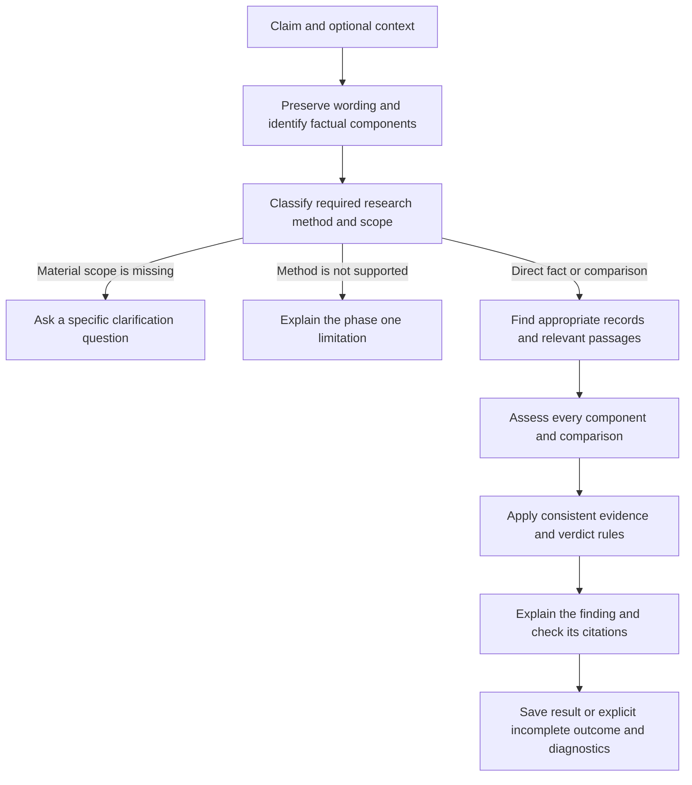

# Phase one direct facts and comparisons

Status: first implementation complete on the implementation branch; see [behavior, compatibility and validation](phase-one-implementation.md). Dataset creation and acceptance evaluation remain pending. Plan recorded 10 November 2026.

Build reliable support for direct facts and direct comparisons before implementing causal, predictive, or other inferential research. The agent must preserve the submitted assertion, recognize the research method it needs, and return a result appropriate to its supported scope. Open a pull request when this first implementation and its required checks are complete. Complete the phase-one evaluation before moving to the next research method.

This document records the implementation scope, evaluation design, and delivery sequence. It does not authorize an immediate bulk generation or provider run. The existing 30 claims, labels, and historical results remain unchanged. The earlier 1,500-claim expansion is deferred in favor of this narrower milestone.

The [pilot diagnosis](evaluation/phase-one-diagnosis.md) explains how we reached this scope. The [evidence handoff for Chandra](evaluation/pilot-handoff/README.md) includes all 30 cases, both runs, and the pipeline used. The first PR packages this evidence and plan; phase-one implementation will be a separate follow-up.

## What phase one supports

| Category | Boundary | Phase-one behavior |
| --- | --- | --- |
| Direct fact | A specified event, property, date, quantity, or other assertion checkable against appropriate records without establishing causation or making a forecast | Research the exact assertion and its material details |
| Direct comparison | Recorded values or properties compared under compatible definitions, units, populations, and periods | Retrieve both sides, verify comparability, and perform the comparison |
| Non-direct claim | Establishing a causal effect, predicting an unrealized outcome, evaluating a counterfactual, or resolving a scientific or interpretive inference | Identify the required method and explicitly report that phase one does not support that investigation |
| Mixed claim | An assertion requires both supported and unsupported methods, or contains independent propositions that cannot be treated as one scoped assertion | Preserve all parts; explain the limitation or request a split rather than silently checking only the easy part |

Domain is metadata, not a routing decision. History, astronomy, economics, technology, public policy, and health can each contain direct and non-direct claims. A numerical comparison of outcomes is not automatically evidence that an intervention caused their difference.

An unknown answer does not make a claim non-direct. An unavailable record can leave a direct claim with insufficient evidence. Conversely, the wording of a scientific existence claim may require an inferential research method rather than a record lookup. Review these boundaries explicitly; do not classify according to the expected truth label or whether a search happens to succeed.

“Unresolved” is an evidence outcome, not an initial claim type. “Needs clarification” is a scope decision, not a substitute for uncertainty or unsupported functionality. A clear non-direct claim should receive an unsupported-method response without a truth verdict, not invented clarification questions.

## Proposed processing flow

### Parse and route without deciding truth

Retain the original claim and identify its subject, predicate, temporal scope, location or population, and material modifiers. Dates in descriptive clauses remain part of the claim. Comparisons additionally identify both operands, the metric, units, baseline, and period. Components must map back to the submitted wording; the parser must not invent missing facts or correct the claim from memory.

Produce separate structured outputs for claim type, scope completeness, required research method, and phase-one support. A short reason should identify the relevant wording. Keep expected labels, reference answers, and evaluation metadata out of agent input.

Request clarification only when missing information materially changes what is being checked. An initial routing error must be revisable with an auditable reason. Changing the amount of research must not change the evidence standard for the same assertion.

### Retrieve and assess evidence

Prefer records appropriate to the proposition. Publisher identity alone does not establish that a passage is authoritative or that two reports are independent.

Select relevant passages across each saved document, preserving nearby context, stable span identifiers, and exact source text. Remove navigation and boilerplate before allocating the passage budget. A truncated assessment window must not automatically invalidate a fully supported, narrow factual lookup; it also must not be treated as a comprehensive review.

Assess each material component separately as supported, contradicted, or not established, with its exact citations. Distinguish evidence about a different entity or population from evidence contradicting the claimed date or quantity for the same entity. Partial support must not become support for the complete assertion.

For direct comparisons, establish compatible units, definitions, periods, and populations before comparing. Use deterministic arithmetic or date comparison where the extracted operands support it. Preserve uncertainty and provenance for the extracted values; arithmetic cannot correct a mistaken extraction.

### Decide and explain

- True requires adequate support for every material component and no unresolved material contradiction.
- False requires evidence contradicting the essential assertion; absence of support alone is insufficient.
- Almost requires a bounded, evidence-backed correction that preserves the essential proposition. A provisional True must remain revisable if a material error is discovered later.
- Insufficient evidence and conflicting evidence remain distinct research outcomes. A conflict must be established between relevant evidence, not manufactured by inconsistent assessment labels.
- Unsupported methods, missing scope, provider errors, and incomplete execution remain separate from factual outcomes.

Apply evidence requirements according to the proposition and research method, consistently across research rounds. Write the explanation from the component findings and decision. A model agreeing with its earlier answer does not establish correctness.

If explanation checking identifies a problem, perform a bounded repair of the affected explanation or assessment. Preserve already verified work, but never publish an unchecked verdict or explanation. If recovery fails, retain an explicit incomplete result and the reason.

### Bound work and retain useful diagnostics

Validate search plans against remaining capacity before execution. A later denied request must not discard usable earlier search results. Isolate a rejected source assessment so it does not automatically destroy the entire investigation; disclose the coverage limitation and do not admit invalid evidence.

Record separate failure stages and codes for provider errors, invalid task output, exhausted budgets, and semantic rejection. Retain the structured decision-check results, affected component or explanation indices, evidence references, and rejected user-facing explanation in a restricted diagnostic artifact. Do not retain credentials, private reasoning, or unrestricted raw provider responses. Diagnostic writes must not replace the original result or failure.

The unsupported-method response and any new structured fields require an explicit API compatibility and persistence design during implementation. Do not overload existing clarification or insufficient-evidence fields to avoid that work. Preserve readable historical results and saved-read behavior.

## Existing regressions to address first

Use the six diagnosed cases from the [saved pilot comparison](evaluation/benchmark-v1-pilot-repaired.md), with their existing snapshots, before authoring more claims. These are development regressions, not an unseen evaluation set.

| Case | Observed failure | Required regression behavior |
| --- | --- | --- |
| b0001 Apollo landing | Relevant landing-date passage excluded by navigation-heavy input; research escalation changes the decision threshold | Relevant passage reaches assessment; the same validated evidence receives the same sufficiency decision regardless of effort profile |
| b0002 Venus distance | Passage contradicting the claim labeled as support; false conflict; oversized search plan loses results | Evidence relation agrees with the comparison; plan fits capacity and preserves completed search work |
| b0004 Europa life | Interpreter invents regional scope requirements and never searches | Preserve the general existence proposition; distinguish research-method support from genuinely missing scope |
| b0006 Antibiotics | Evidence gate succeeds, final explanation is rejected, and the diagnostic cannot identify the failed condition | Preserve verified work and record exactly which final-check condition failed, with bounded recovery |
| b0023 Rosetta Stone | Discovery year confused with campaign year; erroneous True blocks correction and passes final checking | Associate each date with its event; check the modifier separately; do not publish True for contradictory discovery dates |
| b0028 Montreal Protocol | Corrected date is already captured, then one repeatedly invalid assessment aborts the whole investigation | Preserve the earlier evidence, reject the invalid assessment, and continue or explicitly report incomplete coverage |

Expected phase-one behavior may differ from the original mixed-task pilot contract, especially for scientific hypotheses. Record new regression expectations separately; never overwrite historical labels or reinterpret prior scores as improved results.

## Proposed 1000 claim evaluation

Planning assumption: **1,000 claims total**, containing both direct and non-direct cases. This evaluates recognition and parsing first. It is not a requirement to perform 1,000 full web investigations.

| Primary label | Proposed count |
| --- | ---: |
| Direct fact | 250 |
| Direct comparison | 250 |
| Causal or effectiveness claim | 150 |
| Prediction or counterfactual | 100 |
| Scientific hypothesis requiring inference | 100 |
| Interpretive or value claim | 75 |
| Mixed methods or independent propositions | 75 |
| Total | 1000 |

These are coverage targets, not reasons to force a label. Include multiple domains, true and false wording, modifiers, negation, explicit and incomplete scope, compatible and incompatible comparison setups, and difficult boundaries. Balance domains across classes so the classifier cannot succeed by treating a topic word as a routing rule. Keep matched variants and paraphrases in the same family.

Each record needs a stable ID, original claim and neutral context, domain, family ID, split, reviewed primary type, phase-one support decision, scope decision, expected components and comparison fields, rationale, label status, and independent reviewer annotations. Add expected factual decisions and supporting passages only for cases selected for end-to-end evaluation. Extend or version the existing evaluation contract explicitly rather than silently changing what its historical fields mean.

Use two independent human labels for type, scope, and parsing expectations, record agreement before reconciliation, and retain disagreements. Generated labels are proposals. Borderline cases need justified case-specific acceptable labels or a separately reported ambiguous subset; do not silently drop them to improve scores.

Proposed split: 200 development cases and 800 held-out cases, stratified by type and grouped by fact/event family. Split before tuning. A separate steward should retain held-out labels; a repository folder alone does not establish an independent private holdout. Do not describe test results as unseen if the cases or labels were used during development. The existing 30 cases are already development material and remain outside this new count.

### Separate evaluation stages

1. **Routing and parsing:** submit only claim and neutral context. No search is needed. Score direct/non-direct recognition, subtype, scope decision, and component preservation across the reviewed set.
2. **Evidence interpretation:** use fixed reviewed passages to distinguish assessment and decision errors from retrieval errors. Do not inject expected answers or source-assessment labels.
3. **End-to-end direct checking:** freeze a stratified subset of direct cases, its reviewed reference evidence, and its run limits before using providers. Measure retrieval, assessment, decision, explanation, and operational outcomes separately. Set the subset size and budget before scheduling it; do not automatically research all 1,000 cases.

Compare configurations on identical development inputs before freezing a candidate for held-out evaluation. Record all attempts, model settings, implementation and dataset hashes, latency, observed token usage, and cost when billing evidence exists. Retesting after examining held-out failures is development work, not another unbiased test.

### Metrics and proposed acceptance targets

The numerical thresholds below are proposed phase-one targets, not achieved results or production guarantees. Freeze them before evaluation. The earlier suggested mixed-pilot targets of 27/30 completed and 24/30 agreement are not acceptance criteria for this narrower contract.

| Measurement | Proposed target or required reporting |
| --- | --- |
| Direct-route precision | At least 95% of claims admitted to direct research are reviewed as direct |
| Direct-route recall | At least 90% of reviewed, sufficiently scoped direct claims are admitted correctly |
| Parsing completeness | At least 95% of cases retain all required material components and comparison fields; report per-field errors too |
| Scope handling | Report unnecessary clarification and missed essential clarification separately; all known six-case scope regressions pass |
| Type classification | Confusion matrix and precision/recall by subtype and domain; do not rely on one overall accuracy number |
| Fixed-evidence and end-to-end quality | Report separately: decision agreement, supported correction quality, citation support/coverage, completion, and confidently wrong decisions |
| Known critical failures | Zero recurrence of the diagnosed contradictory-date True verdicts, reversed comparison support, or route-dependent sufficiency in the development regressions |
| Operational behavior | Relevant offline API/persistence/regression checks pass; bounded retries, retained progress, and safe diagnostics are verified |

Count errors, unclassified outputs, and inappropriate clarification in the relevant denominators. Evaluate type classification on all reviewed claims, including those needing clarification; evaluate direct-route admission on cases whose reviewed scope is sufficient. Correct requests for essential missing scope must not count as routing misses. Report ambiguity, review coverage, and uncertainty. Eligible ground-truth direct cases incorrectly routed away must remain failures in end-to-end reporting rather than disappearing from the tested population. “Completed” includes legitimate supported research abstentions, but excludes execution failures and unsupported-method responses. A high classification score does not establish factual or citation accuracy.

## Delivery sequence and pull request

1. **Document and hand off evidence:** submit the plan, six-case analysis, all 30 original cases with both saved runs, and the historical pipeline as a focused PR for Chandra's review. No new claim generation or live evaluation in this step.
2. **Implement phase one:** build parsing/routing, direct evidence checking, comparison handling, component-level decisions, and bounded failure recovery. Address the six known regressions using saved evidence and meaningful offline tests. Document API/persistence changes and any migrations.
3. **Open the implementation PR:** once the implementation and required checks are complete, push its focused branch and open a PR. Include the behavior change, regression evidence, executed validation, and unresolved limitations. Keep unrelated generation experiments and local credentials/artifacts out of the PR. Do not wait to combine it with causal or predictive research. If the 1,000-claim evaluation is pending, state that explicitly rather than claiming evaluated readiness.
4. **Evaluate recognition and direct checking:** create and review the proposed dataset, freeze the splits and evaluation settings, run classification first, then the separately bounded evidence and direct-research evaluations. Link the resulting evidence to the implementation PR or a focused follow-up. Keep evaluation failures visible and repair against development cases.
5. **Advance only after phase-one acceptance:** review the measured results and limitations before starting the next research method. The first PR is an implementation milestone, not automatic permission to claim broad research capability.

Current step: a separate implementation PR follows the documentation/evidence handoff. No 1,000-claim dataset has been generated; acceptance evaluation remains pending.
