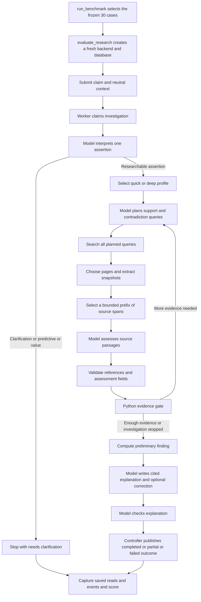

# Pipeline used for the saved pilot

Both runs used the real FastAPI application, SQLite persistence, Nebius model adapter, and Tavily search/extraction adapter. The wrapper created a fresh application/database per case and saved public API results, evidence, events, scores, and safe provider-attempt metadata. Expected answers and benchmark source leads were used for scoring, not supplied as research answers.

This describes the historical pipeline, including its defects. The [phase-one plan](../../direct-claims-phase-one.md) describes a different proposed flow.



## Run controls

| Setting | Original | Rerun |
| --- | --- | --- |
| Cases | Same 30 original claims | Same 30 original claims |
| Model | nvidia/Nemotron-3_5-Lightning | Same |
| Thinking | disabled | disabled |
| Response format | json_schema | json_schema |
| Output token cap | 4096 | 4096 |
| Provider timeout | 45 seconds | 45 seconds |
| Provider max retries | 2 | 2 |
| Concurrent independent cases | 1 | 3 |
| Quick model attempts, including repairs | 8 | 10 |
| Deep model attempts, including repairs | 16 | 16 |
| Quick / deep search attempts | 4 / 8 | 4 / 8 |
| Quick / deep extraction units | 4 / 10 | 4 / 10 |
| Finalization reserve | 4 model calls and 45 seconds | Same |
| Quick / deep hard deadlines | 120 / 240 seconds | Same |
| Initial quick / deep page ceiling | 2 / 4 | 2 / 4 |
| Follow-up rounds and page ceiling | At most 2 rounds, 2 pages per round | Same |
| Assessment input ceiling | 120 spans and 12000 characters per source | Same, with limited navigation filtering |

Profile escalation retains the original clock and used-attempt counters. Per-task validation gets at most one repair. The final semantic veto occurs outside that task repair loop. A rejected source assessment can abort the investigation. Search planning is given remaining capacity but its validator does not enforce the query-count ceiling against that capacity.

Quick sufficiency permits a source assessed as an authoritative record. Deep sufficiency instead requires an eligible synthesis or distinct established origins. All source limitations disqualify a source from the synthesis shortcut. These are observed implementation rules, not endorsements of their adequacy.

The wrapper's successful exit means all attempts were recorded without a wrapper/configuration stop; it does not mean the backend completed or answered every claim correctly. Resume skips already attempted cases rather than quietly retrying failed cases. Both retained runs recorded all 30 attempts.

## Source map

| Responsibility | Archived file |
| --- | --- |
| Selection, concurrency, resume, aggregate scoring | [run_benchmark.py](rerun-runtime/scripts/run_benchmark.py) |
| Fresh backend lifecycle and capture | [evaluate_research.py](rerun-runtime/scripts/evaluate_research.py) |
| Dataset contract and summary metrics | [benchmark.py](rerun-runtime/src/aletheia/benchmark.py) |
| Claim interpretation and profile choice | [claims.py](rerun-runtime/src/aletheia/claims.py) |
| Research orchestration and terminal handling | [orchestrator.py](rerun-runtime/src/aletheia/orchestrator.py) |
| Planning and remaining-capacity input | [planning.py](rerun-runtime/src/aletheia/planning.py) |
| Search, extraction, snapshots | [research.py](rerun-runtime/src/aletheia/research.py) |
| Passage selection and assessment prompt | [verification.py](rerun-runtime/src/aletheia/verification.py) |
| Citation admission and scope guard | [evidence.py](rerun-runtime/src/aletheia/evidence.py) |
| Sufficiency, verdict, correction, final check | [verdicts.py](rerun-runtime/src/aletheia/verdicts.py) |
| Task repair and safe diagnostics | [tasks.py](rerun-runtime/src/aletheia/tasks.py) |
| Attempt/deadline limits | [budgets.py](rerun-runtime/src/aletheia/budgets.py) |
| Persistent records and replay | [storage.py](rerun-runtime/src/aletheia/storage.py) |

## Reproduction boundaries

The records reproduce the observations; a new live run will not necessarily reproduce the answers because model inference and live retrieval can change. The current application at the repository root is not an exact snapshot of the repaired pilot. Inspect the frozen `rerun-runtime` directory for that implementation.

For offline dataset validation with the archived runtime, install its locked dependencies in an isolated environment, then run from its directory:

```sh
uv sync --locked
uv run --locked python scripts/run_benchmark.py --cases ../claims.json --pilot
```

This invocation validates the dataset without provider calls. The archived runner uses `fcntl` and requires a compatible POSIX system; it is not a Windows-portable runner. The standard-library handoff inspector at the repository root does not have that restriction.

The historical live invocation additionally supplied `--live`, a fresh `--output`, an explicitly configured runtime `--dotenv` path, `--model nvidia/Nemotron-3_5-Lightning`, `--thinking disabled`, and concurrency 1 or 3. No working credentials or machine-specific configuration paths are included. Reviewing this handoff does not require or request another live run.
