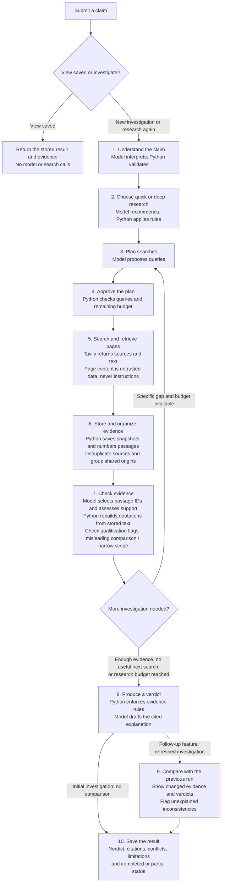
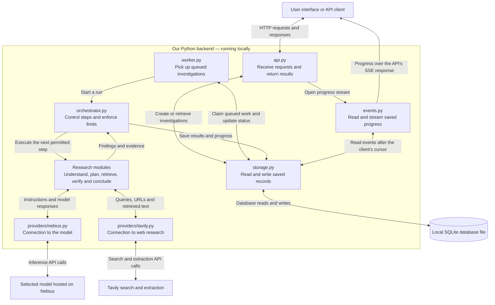

# Aletheia system design and research flow

This document explains the proposed V1 backend in two views: the research steps in order, and the modules, APIs, and storage that carry out those steps. The [README](../README.md) defines the detailed contracts and implementation plan.

**Build order:** first deliver one complete investigation, saved reads, and protection against duplicate initial submissions. Refresh versioning, comparison, and refresh-specific idempotency are the first follow-up after the minimum works. Their contracts remain below and are marked as follow-up features.

**Quick and deep are two research settings within the same pipeline.** They change the research instructions, evidence requirements, and budget; the steps below remain the same.

## Who does what?

- **Nebius connection:** carries instructions and responses between our Python code and the selected model at the model-assisted steps. The connection code is also called an adapter; the calling module owns the task instructions.
- **Tavily connection:** carries approved queries and page-extraction requests to Tavily and returns retrieved sources and text.
- **Python controller:** runs the sequence, validates model outputs, enforces budgets, saves results, and records progress throughout.

## How to read the branches

- **Saved view:** return an existing investigation with its original timestamp. An exact repeated submission reuses its saved result or active status; it never silently starts another paid investigation.
- **Research again (follow-up feature):** explicitly create a new version. Revisit sources and gather new evidence, form the new assessment independently of the old verdict, then compare versions at step 9. For a first investigation, comparison is not applicable.
- **More research:** name the evidence gap before returning to planning. Escalate quick to deep when needed; never reset accumulated usage or downgrade deep to quick.

## Outcomes and limits

The diagram shows the main research path. These rules apply at every step:

- Material ambiguity produces clarification questions before dependent research begins.
- Budget exhaustion stops new research and uses reserved finalization capacity where available. A hard deadline starts no further model or search calls, including synthesis or an optional consistency review.
- **Completed** means the required checks finished and research stopped normally. Its verdict can still be **insufficient evidence**.
- **Partial** means work stopped early but a usable validated result exists; show the unfinished work and reason.
- **Failed** means no usable validated final result could be produced; return no final factual verdict. A service failure is not evidence against the claim.
- At step 7, passage IDs are scoped to stored source snapshots. Code rebuilds source-ordered excerpts; non-adjacent excerpts stay separate. This establishes quotation integrity against extracted text, not source truth or semantic support by itself.
- At step 9 (follow-up feature), matching quotation text alone does not establish unchanged evidence. Compare the scoped claim, relevant evidence set, source context, and provenance. Keep unexplained inconsistency flags visible even when automatic rechecks are disabled or out of budget.

The four factual verdicts are **supported**, **contradicted**, **mixed**, and **insufficient evidence**. They are separate from execution status. Findings also retain applicable qualification flags, such as misleading comparisons or narrower evidence scope, as defined in the README.

## System architecture and dataflow

The application's saved investigations live in a **local SQLite database file on the computer running the backend**. Its location will be configurable; this design does not yet prescribe a filename. These are proposed components and contracts, not a claim that the backend or database has been implemented.

The API accepts work, the worker performs it, and storage preserves it. Requests return promptly so a client can display progress while research continues.

Arrows in this component diagram describe communication, not chronological research steps. The ten-step diagram above describes execution order. The event stream is part of the same API, not another server. One background worker processes persisted queued runs in V1; there is no separate queue service.

## API endpoints

An endpoint is an address the frontend calls to request a specific action. `{id}` is the investigation ID returned when a run is created or reused.

| Endpoint | What it does | Starts research? |
| --- | --- | --- |
| `POST /investigations` | Submit a claim and context. Return an exact existing investigation or queue a new one. | Only for new claim/context. |
| `GET /investigations/{id}` | Return current status, clarification questions, an error, or the saved final answer. | No. |
| `POST /investigations/{id}/refresh` | **Follow-up feature.** Research again as a new version linked to the selected earlier run. Require an idempotency key to prevent duplicate work on retries. | Yes, for an eligible terminal run. |
| `GET /investigations/{id}/events` | Stream persisted progress events; reconnect after the last received event. | No. |
| `GET /investigations/{id}/evidence` | Return source details, quoted passages, and verification results. | No. |
| `GET /investigations/{id}/comparison` | **Follow-up feature.** Return the saved differences between versions, or the comparison status. | No. |
| `GET /health` | Check local application/database health without paid provider probes. | No. |

A new investigation returns `202 Accepted` and its ID before research finishes. An exact existing active run also returns `202`; an existing terminal run returns `200` with its original timestamps and `reused: true`. The frontend uses the ID for progress, evidence, and results. Merely reading a result never makes provider calls. Full validation, error, and refresh rules remain in the README.

## Research modules: inputs and outputs

These are Python modules inside one backend, not separate servers. The controller calls them in order and handles any permitted follow-up loop.

| Module | Receives | Produces |
| --- | --- | --- |
| `claims.py` | Claim and supplied context. | Scoped assertions, clarification questions when needed, and a code-assigned quick/deep route. |
| `planning.py` | Assertions, route, named evidence gaps, and remaining limits. | Validated query proposals linked to assertions and search purposes; the controller approves execution against the budget. |
| `research.py` | Approved queries and selected source URLs. | Tavily search results, extracted page text, and retrieval outcomes. |
| `evidence.py` | Retrieved pages and metadata. | Stored source snapshots, duplicate/origin observations, content fingerprints, and immutable numbered passages. |
| `verification.py` | Assertions and snapshot-scoped numbered passages. | Validated support/contradiction assessments, code-rebuilt excerpts, scope qualifications, and limitations. |
| `verdicts.py` | Validated evidence assessments. | Assertion and overall verdicts, cited explanations, conflicts, and qualification flags. |
| `comparison.py` (follow-up) | New findings and the selected previous investigation, if present. | Evidence/verdict differences, consistency flags, and optional review outcomes. |

An individual citation follows this chain: **claim → query → retrieved page → stored snapshot → numbered passage → evidence assessment → cited finding**. IDs preserve the links between those records. A source may support multiple assertions, but each support judgment is assessed separately.

If verification identifies a specific evidence gap, the controller can return to `planning.py` for another search round within the remaining budget. The old verdict is not supplied as an answer the new run must preserve.

## Provider connections

| Connection | What passes out | What comes back |
| --- | --- | --- |
| `providers/nebius.py` | The calling module's instructions, necessary claim/evidence context, output schema, and supported model settings. | Parsed model response, usage information, or a typed error. |
| `providers/tavily.py` | Approved search queries or selected URLs for extraction. | Search results or extracted content, metadata, and per-request/per-URL outcomes. |

Nebius helps interpret claims, propose queries, assess evidence, draft explanations, and optionally review inconsistencies. Tavily retrieves web evidence. Python validates outputs and references, rebuilds quotations, applies routing and verdict rules, controls budgets, and persists records.

Retrieved page text remains separate from trusted task instructions in model requests. Instructions embedded in a source cannot authorize tools or change the research rules.

The adapters handle communication and provider-specific formats. They do not decide which pipeline stage runs next or write the final answer to the database themselves. Credentials are loaded by runtime configuration and stay out of frontend responses, progress events, and saved public traces.

## What is saved, and where

All records below are tables in the **same local SQLite database file**. `storage.py` provides the operations used to save and retrieve them.

| Table | Saved information |
| --- | --- |
| `claim_requests` | Original claim, supplied context, and the exact-match key used to find repeated submissions. |
| `investigations` | Run ID, version, parent run, status/stage, timestamps, stop reason, settings, usage, result, clarification questions, or sanitized error. |
| `assertions` | Each checkable assertion and its individual finding, including qualification flags. |
| `source_snapshots` | URL, available source metadata, retrieval time, original/normalized extracted text, normalization version, and content fingerprints. |
| `text_spans` | Numbered passages, their snapshot IDs, and exact positions inside normalized source text. |
| `evidence_assessments` | Which assertion a passage addresses, support relation, cited spans, rebuilt excerpts, validation results, and limitations. |
| `provider_calls` | Sanitized request/visible-response records or references, timing, usage, and errors. |
| `events` | Ordered progress events that can be streamed and replayed after reconnecting. |
| `comparisons` (follow-up) | Version differences, evidence fingerprints, inconsistency findings, and optional recheck status. |
| `idempotency_keys` (refresh follow-up) | A request key mapped to its created run, preventing a retried refresh from launching duplicate work. |

Retrieved source text is saved when it arrives, not just its URL. This preserves the evidence used by an older investigation even if the webpage changes later. Snapshot-scoped passages link the saved text to assessments, and assessments link it to findings.

Progress is persisted before being streamed. Final result, terminal status, and terminal event are committed together so a client cannot see “completed” without a saved result. Provider network calls do not hold database transactions open.

Saved terminal results and source snapshots remain immutable from the initial version. When refresh is added, it saves a new version rather than overwriting the original. The database and run artifacts are excluded from Git. Secrets and private model reasoning are excluded from public traces; raw page bodies are not returned by the evidence endpoint by default.

## Supporting modules

| Module | Responsibility |
| --- | --- |
| `main.py` | Start the app and worker, connect dependencies, handle shutdown, and reconcile interrupted runs. |
| `config.py` | Load runtime credentials and settings, including model selection, database location, and limits. |
| `contracts.py` | Define and validate request, evidence, event, finding, and result shapes. |
| `budgets.py` | Track attempts/time and prevent work from exceeding configured limits. |
| `prompts/` | Hold versioned instructions for each model-assisted task. |
| `events.py` | Define safe progress payloads and provide resumable event streams through the API. |
| `storage.py` | Own database schema, exact lookup, queue records, snapshots, ordered events, and atomic finalization. |
| `worker.py` | Pick up persisted queued runs one at a time and invoke the controller. |
| `orchestrator.py` | Coordinate research modules, check allowed transitions and budgets, and save outcomes through storage. |
| `api.py` | Validate incoming requests and expose the endpoints above without performing the whole investigation inside the request handler. |

## Three end-to-end paths

1. **New claim:** frontend → API → saved queued run → worker → controller/research modules → Nebius and Tavily as needed → saved evidence and events → final saved result. The frontend subscribes to events and fetches the result using the investigation ID.
2. **View saved:** frontend → API → storage → SQLite → stored answer and evidence. There are no model or search calls; original research timestamps remain visible.
3. **Research again (follow-up feature):** frontend → refresh endpoint → new linked run → fresh research → comparison with the selected baseline → saved new result and differences. The previous version remains available, and inconsistency flags survive even if automatic review is disabled.

The frontend displays the backend's findings and citations. It does not hold provider keys or make its own truth judgments. A hosted replay client, if built, displays explicitly labeled exported investigations rather than calling this local backend.
