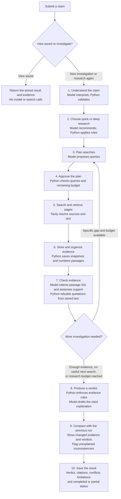

# Aletheia research flow

This is a simplified view of the proposed V1 backend. The [README](../README.md) defines the detailed contracts and implementation plan.

**Quick and deep are two research settings within the same pipeline.** They change the research instructions, evidence requirements, and budget; the steps below remain the same.

## Who does what?

- **Nebius connection:** carries instructions and responses between our Python code and the selected model at the model-assisted steps. The connection code is also called an adapter; the calling module owns the task instructions.
- **Tavily connection:** carries approved queries and page-extraction requests to Tavily and returns retrieved sources and text.
- **Python controller:** runs the sequence, validates model outputs, enforces budgets, saves results, and records progress throughout.

## How to read the branches

- **Saved view:** return an existing investigation with its original timestamp. An exact repeated submission reuses its saved result or active status; it never silently starts another paid investigation.
- **Research again:** explicitly create a new version. Revisit sources and gather new evidence, form the new assessment independently of the old verdict, then compare versions at step 9. For a first investigation, comparison is not applicable.
- **More research:** name the evidence gap before returning to planning. Escalate quick to deep when needed; never reset accumulated usage or downgrade deep to quick.

## Outcomes and limits

The diagram shows the main research path. These rules apply at every step:

- Material ambiguity produces clarification questions before dependent research begins.
- Budget exhaustion stops new research and uses reserved finalization capacity where available. A hard deadline starts no further model or search calls, including synthesis or an optional consistency review.
- **Completed** means the required checks finished and research stopped normally. Its verdict can still be **insufficient evidence**.
- **Partial** means work stopped early but a usable validated result exists; show the unfinished work and reason.
- **Failed** means no usable validated final result could be produced; return no final factual verdict. A service failure is not evidence against the claim.
- At step 7, passage IDs are scoped to stored source snapshots. Code rebuilds source-ordered excerpts; non-adjacent excerpts stay separate. This establishes quotation integrity against extracted text, not source truth or semantic support by itself.
- At step 9, matching quotation text alone does not establish unchanged evidence. Compare the scoped claim, relevant evidence set, source context, and provenance. Keep unexplained inconsistency flags visible even when automatic rechecks are disabled or out of budget.

The four factual verdicts are **supported**, **contradicted**, **mixed**, and **insufficient evidence**. They are separate from execution status. Findings also retain applicable qualification flags, such as misleading comparisons or narrower evidence scope, as defined in the README.
